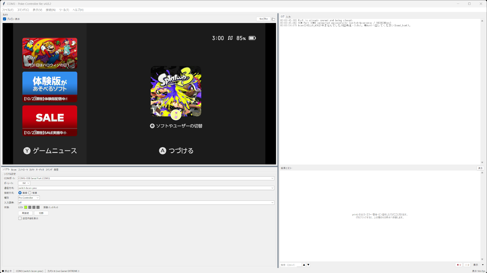

# Poke-Controller Re:

Poke-Controller Modified の開発履歴を引き継ぐ、Nintendo Switch 向けの操作・自動化ツールです。映像・音声認識や Python スクリプト、Blockly によるビジュアルプログラミングでの自動操作に対応しています。

## プロジェクトの系譜

[KawaSwitch/Poke-Controller](https://github.com/KawaSwitch/Poke-Controller) を元にした [Poke-Controller Modified](https://github.com/Moi-poke/Poke-Controller-Modified) の `release/v4.0` を、コミット履歴ごと引き継いだ独立リポジトリです。今後の開発は [Moi-poke/Poke-Controller-Re](https://github.com/Moi-poke/Poke-Controller-Re) の `main` ブランチで行います。旧 Modified 版の `master` ブランチは従来版の保守用とし、原則としてセキュリティ修正および重大な不具合の修正のみに限定します。

既存の自作スクリプト（`Commands.*`）と `settings*.ini` の形式は従来から変更しません。また、MIT ライセンスと元の著作権表示を引き継ぎます。



## Installation

### 一般ユーザー

パッケージ管理には `uv` を採用しており、[`pyproject.toml`](pyproject.toml) と [`uv.lock`](uv.lock) が依存関係の構成基準です（`requirements.txt` はありません）。Python のバージョンは `3.12.15` 固定（[`.python-version`](.python-version) 参照）で、`uv sync` を実行すると自動的に用意されます。

`uv` は `0.13.5` 以上が必要です（[`pyproject.toml`](pyproject.toml) の `required-version` で検証されます）。

```cmd
pip install "uv>=0.13.5"
uv sync
.\.venv\Scripts\activate
python .\SerialController\Window.py
```

複数台を並列で動かしたい場合は、ランチャーを使うかプロファイルを指定します。プロファイルごとに `SerialController/settings.<名前>.ini` が自動で作成されます。


```cmd
python .\SerialController\launcher.py
python .\SerialController\Window.py --profile switch1
python .\SerialController\Window.py --profile switch1 --transport switch-bcon
```

組み込みの通信方式は以下の 2 種類です（`--transport` を省略した場合は設定ファイルの `[Transport] name` を使用します）。

- `legacy_text`: 本家 Arduino Leonardo 向けの従来方式
- `switch-bcon`: Raspberry Pi Pico 2 W 向けのバイナリ通信方式（別プロセス送受信が標準。旧設定名 `bcon` / `switch-bcon-proc` も互換別名として読み込み時に `switch-bcon` へ解決されます）

通信方式の詳細は [`docs/BCON_TRANSPORT.md`](docs/BCON_TRANSPORT.md) をご覧ください。

### 不具合の報告

エラーが発生したときは、メニューの「ヘルプ → エラー報告をコピー...」を開いてください。実行環境・エラー内容・ログ末尾をまとめた文面が出力されるため、そのままコピーして [Issue](https://github.com/Moi-poke/Poke-Controller-Re/issues) に貼り付けられます。なお、`settings.ini` の中身や Discord の Webhook URL などの機密情報は含まれません。

- ログファイル本体は `log/` 直下（`log_日時.log`）に起動ごとに作成されます。Issue に添えていただくと原因を追跡しやすくなります。
- `log/` 内のファイルが増えてきた場合は、古いものから手動で削除してかまいません（自動削除は行いません）。

### 外部 AI でスクリプトを作る

ご自身の clone を Codex や Claude Code などのワークスペースとして開き、既存の Blockly CLI を使って作品を作成・編集できます。追加の前提条件や依頼例については、[外部 AI の利用手順](docs/AI_AUTOMATION.md) をご覧ください。

Poke-Controller Re: 本体への LLM 組込みや、利用者ごとの skill の別途インストールは不要です。

### 開発する方

開発用コマンドはタスクランナー `task` にまとめています。`task` 本体を別途導入（`winget install Task.Task`）したうえで、`task setup_dev` を実行して Git フックを有効化してください。開発時の規約や設計方針は [AGENTS.md](AGENTS.md) をご覧ください。

- `task app`: 本体を起動します（`task app PROFILE=switch1` でプロファイルを指定できます）。
- `task test`: 単体テストを実行します。
- `task ci`: 一通りの検査を実行します（ruff・整形確認・mypy・境界検査・公開 API 検査・公開 API 面検査・参照検査・単体テスト）。

`task` が無い環境では、[`taskfile.yml`](taskfile.yml) に記載されている `uv run ...` コマンドを直接実行してください。

## 使い方・主要機能

詳しいセットアップ手順や画面ごとの使い方は、**[Poke-Controller Re: Wiki](https://github.com/Moi-poke/Poke-Controller-Re/wiki)** を中心にご案内しています。また、本リポジトリ内のドキュメントでも各機能の詳細を解説しています。

- [Blockly エディタ（ビジュアルプログラミング）](docs/BLOCKLY_EDITOR.md)
- [BCON 通信（Pico 2 W 接続・設定）](docs/BCON_TRANSPORT.md)
- [HidHide 設定（Switch Pro コントローラ HID 直結）](docs/HIDHIDE.md)
- [ログ欄の見方と出力機能](docs/LOG_VIEW.md)
- [外部 AI でのスクリプト作成](docs/AI_AUTOMATION.md)
- [ver4.0.0 の主な変更点](docs/V4_CHANGES.md)

本アプリの不具合報告や改善要望は [Poke-Controller Re: の Issue](https://github.com/Moi-poke/Poke-Controller-Re/issues) へお寄せください。また、本家 Poke-Controller の [GitHub Wiki](https://github.com/KawaSwitch/Poke-Controller/wiki)・[Q&A](https://github.com/KawaSwitch/Poke-Controller/wiki/Q&A)・[解決済み Issue](https://github.com/KawaSwitch/Poke-Controller/issues?q=is%3Aissue+is%3Aclosed) も過去の参考資料としてご覧いただけます。

### コマンド作成と主な機能

Python スクリプトによる自動化では、以下のような入力操作や画像認識・音声認識ライブラリを利用できます。

- **通常のボタン押下**

  ```python
  self.press(Button.A)  # Aボタンを押して離す
  self.press(Button.A, 0.1, 1)  # Aボタンを0.1秒間押して離した後、1秒待機
  self.pressEvery(Button.A, 0.09, 0.05)  # 0.09秒間隔で0.05秒間押す（連打の周期指定）
  ```

- **左右スティック・十字キー（HAT）**

  ```python
  self.press(Direction.RIGHT, 5)  # 左スティックを右に5秒間倒す
  self.press(Hat.LEFT)  # 十字キー左を押して離す
  ```

  スティックの可動範囲を単位円とみなし、傾きの強さ（半径 `r`）を `0` 以上 `1` 以下で指定できます。たとえば `Direction(Stick.LEFT, θ, r)` は、左スティックの座標が `x = r * cosθ`、`y = r * sinθ` となるように入力します（`r` を省略した `Direction(Stick.LEFT, θ)` は既定値 `r = 1.0` として認識されます）。詳しくは [`SerialController/Commands/PythonCommands/`](SerialController/Commands/PythonCommands) に同梱されているサンプルコード（`Stick_Sample1.py` / `Stick-Sample2.py` など）と、Switch 本体の「スティックの補正」画面をあわせてご確認ください。

- **同時押し・ホールド**

  ```python
  self.press([Button.A, Button.B])  # AボタンとBボタンを同時に押して離す
  self.hold([Direction.UP, Direction.R_DOWN], wait=1)  # 左スティックを上、右スティックを下に倒して1秒待つ
  self.press(Button.A)  # スティックを倒した状態でAボタンを押して離す
  ```

- **Python ファイル管理・コマンド切替・リロード**
  - 自作コマンドのクラスは [`SerialController/Commands/PythonCommands/`](SerialController/Commands/PythonCommands) 配下に配置します。1 つの Python ファイル内に複数クラスを記述できるほか、サブフォルダを作成して自由に整理できます。
  - 配置したコマンド群は GUI 上からマウス操作で簡単に切り替えられます。また、Poke-Controller Re: を起動したままリロード機能でファイルの変更を再読み込みできるため、試行錯誤しながらデバッグしたい場合にも便利です。
  - 詳しい作成方法は同梱のサンプルや本家の [Python コマンド作成 How-to](https://github.com/KawaSwitch/Poke-Controller/wiki/Python%E3%82%B3%E3%83%9E%E3%83%B3%E3%83%89_%E4%BD%9C%E6%88%90How_to) も参考になります。作成したコマンドや改善案は、ぜひ [本リポジトリのプルリクエスト](https://github.com/Moi-poke/Poke-Controller-Re/pulls) や [Issue](https://github.com/Moi-poke/Poke-Controller-Re/issues) へお寄せください。

- **画像認識・音声認識・範囲キャプチャ**
  - キャプチャボードで Switch の画面を取り込むことで、`self.isContainTemplate('status.png')` などのテンプレートマッチングによる画像認識を行えます。認識した箇所はプレビュー上に青枠で表示されます（引数に `show_position=False` を渡すと非表示にできます）。
  - プレビュー画面上で `Ctrl+Shift+左クリック` しながらドラッグすると、指定した範囲を画像としてキャプチャできます。保存した範囲と保存先（失敗時は失敗した旨）は画面下のログ欄に表示されます。また、`Ctrl+左クリック` でクリック点の座標を確認できます。
  - `AudioPythonCommand` による音声認識・音声トーン検知にも対応しています。

- **Blockly エディタ・マクロ記録・通知**
  - ブラウザ上でブロックを組み合わせて Python コマンドを生成・試し実行できる **Blockly エディタ**（[`docs/BLOCKLY_EDITOR.md`](docs/BLOCKLY_EDITOR.md)）、ボタン操作を録画して Python コマンドとして保存・再実行できる **マクロ記録**、**Discord 通知**機能も備えています。

### キーボード操作

キーボードを Switch のコントローラとして使用できます。

| Switch コントローラ | キーボード |
| ---- | ---- |
| A, B, X, Y, L, R | `'a'`, `'b'`, ... キー |
| ZL | `'k'` キー |
| ZR | `'e'` キー |
| MINUS | `'m'` キー |
| PLUS | `'p'` キー |
| LCLICK | `'q'` キー |
| RCLICK | `'w'` キー |
| HOME | `'h'` キー |
| CAPTURE | `'c'` キー |
| 左スティック | 矢印キー |

割り当てはメニューの「キーコンフィグ」から変更できます（テンキー数字の区別やプロファイル別の保存に対応しています）。

### ゲームパッド操作（Windows のみ）

PC に接続したコントローラを Switch のコントローラとして使用できます。コントローラタブの「ゲームパッドで操作」にチェックを入れると、シリアル接続中にパッドの入力がそのまま Switch へ届きます。Xbox 系（XInput）に加え、Switch Pro コントローラなどの XInput 非対応品も使用できます。

> **Switch Pro コントローラの HID 直結（ジャイロ含む）を使う場合**
> Steam / SDL との HID 競合を避けるため、[HidHide の設定](docs/HIDHIDE.md) が必要です。HidHide をインストールしたあと、`ツール > HidHide 設定...` で `セットアップ` を押すと、接続中の Pro Controller をそのまま使えるようになります（コントローラタブの「HidHide セットアップ」からも開けます。再起動は不要です）。HidHide が未設定のときは、「ゲームパッドで操作」のチェック自体が無効になります。通常の入力経路は HID 直結だけで、SDL はデバッグ用（`POKECON_SDL_DEBUG`）です。

| Switch コントローラ | ゲームパッド |
| ---- | ---- |
| A, B, X, Y | A, B, X, Y ボタン |
| L, R | LB, RB ボタン |
| ZL, ZR | LT, RT トリガー（押し込みで入力） |
| MINUS, PLUS | BACK, START ボタン |
| LCLICK, RCLICK | 左・右スティック押し込み |
| 十字キー | 十字キー |
| 左・右スティック | 左・右スティック |

### 画面を配信・録画する（OBS など）

メニューの「16:9 に固定」を ON にすると、タイトルバー・メニューを含む**ウィンドウの外枠**が 16:9 になります。OBS の「ウィンドウキャプチャ」で「クライアント領域のみ」を ON にしている場合は中身だけが切り出されて 16:9 にならないため、OFF にしてご使用ください。

## おまけ

- **表示サイズ・FPS の変更**: 好みの表示サイズや FPS がある場合は、Camera 欄のドロップダウンから変更できます（`settings*.ini` に保存されます）。
- **Pokémon HOME 連携のフォルム対応**: フォルム別の名前があるポケモン（ロトムなど）は標準では第 7 世代までに対応していますが、[`SerialController/db/poke_form_name.csv`](SerialController/db/poke_form_name.csv) に追記することで追加のフォルムにも対応できます。
- **OpenCV の NVIDIA GPU（CUDA）対応**: OpenCV で行う画像認識を NVIDIA GPU（CUDA）で動かしたい場合、CUDA 対応版の OpenCV が導入されていれば自動で使用します（`isContainTemplateGPU` 系。見つからない場合は CPU に切り替わります）。ただし、`pip install` で入る通常版の OpenCV には CUDA が含まれていないため、利用するにはお使いの GPU に対応したオプションで Python 用の OpenCV をソースからビルドする必要があります。それなりに手間のかかる作業になりますが、余裕のある方は「`OpenCV + CUDA (+ Windows)`」などで検索して解説ページを参照してみてください。
- **SciPy による文字入力の最適化**: SciPy は最短経路の算出に使用しています。具体的には、Switch のソフトウェアキーボードを有向グラフに見立てて文字入力の最適化を試みており、サンプルコードを同梱しています。興味のある方はぜひお試しください。
- **スクリプト内のログ出力**: マクロプログラム中でのログ出力（`print` / `print2` / 警告・エラーの書き方 / `logger` の使い分け）については、[`SerialController/Commands/PythonCommands/LoggingSample.py`](SerialController/Commands/PythonCommands/LoggingSample.py) および [`docs/LOG_VIEW.md`](docs/LOG_VIEW.md) をご覧ください。

## 変更点

### Re:への移行

- Modified 版の `release/v4.0` から開発履歴を継承し、開発先を新リポジトリの `main` へ移しました。
- アプリ・ランチャーの表示名、ヘルプおよび不具合報告の案内先を更新しました。
- 通信方式、自作スクリプトの公開 API、設定ファイル・作品ファイルの形式は従来どおりです。
- CI の Python も [`.python-version`](.python-version) を正本として `uv` で用意し、Windows 用インストーラーの提供状況に依存しない構成にしました。

### 開発中（main）

- レイアウトに「タブを右（全高）」を追加し、新規プロファイルの既定にしました。既存の設定は従来の「ログを右」を保持します。
- プレビューとログの配分を映像優先にし、16:9 の映像が必要な高さで止まるよう調整しました。
- ログ欄を「ログ / 入力 / 結果とエラー」に分離しました（`tabs_right` 時。件数表示から結果タブへ移動できます）。
- 実行バーをカメラ枠の外へ出し、標準レイアウトでも待機中・実行中・停止を確認できるようにしました。
- BCON タブを 1 列化し、「状態 → 操作 → 折りたたみ」の順に整理しました。無効理由、表記、LED の未取得表示も統一しています。

### ver4.0.2

- BCON 設定を別ウィンドウから設定タブへ移しました。通信方式が `switch-bcon` / `switch-bcon-proc` のときだけ「シリアル」の隣に「BCON」タブが出ます（メニューの「BCON 設定」はこのタブを前面に出します）。
- 起動直後に画面全体が固まることがある不具合を修正しました（プレビュー描画の更新ループが他の定期処理を止めていました）。
- photo 描画のとき、プレビュー上のマウスによるスティック操作が効かない不具合を修正しました。
- `Ctrl+Shift+左クリック` ドラッグの範囲キャプチャで、保存した範囲と保存先（失敗時は失敗した旨）をログ欄へ表示するようにしました。
- Switch-bcon への再接続要求・BOOTSEL 要求を、ACK が返るまで再送する形に変更しました。
- 新しいフレームが来なくてもオーバーレイ（スティック表示など）だけを描き直せるようにしました。

### ver4.0.1

- Blockly エディタの機能を拡充しました（詳細は [`docs/BLOCKLY_EDITOR.md`](docs/BLOCKLY_EDITOR.md) をご覧ください）。
  - サブルーチン（引数・戻り値）、スティック内蔵パッド、表示・スクショ・Discord 通知に対応しました。
  - 保持・終了・連打、音声トーン検知（2 帯域・画像音声併用）、画像認識の複合操作・件数取得に対応しました。
  - 経過時間、実行前設定ダイアログ、プログラムのタグ、動作確認用サンプル 11 種を追加しました。
- BCON 通信方式を追加しました（詳細は [`docs/BCON_TRANSPORT.md`](docs/BCON_TRANSPORT.md) をご覧ください）。
- キーコンフィグを修正し、テンキー数字をメイン行と区別して「テンキー0」〜「テンキー9」と表示するとともに、プロファイル別の保存に対応しました。
- マクロ記録機能を追加し、ボタン操作を録画して Python コマンドとして保存・再実行できるようにしました。
- BCON 設定画面を拡充し、BOOTSEL 再起動・RUMBLE 表示・baud 切替・プレイヤーランプ表示・取込の保存確認（「取込を保存しました。」）に対応しました。
- 取込・BEACON の前提表示を追加し、有線接続中は拒否される旨を表示して「無線にする」での切替を案内するようにしました。
- スクリプト配布の依存導入で、不足する依存は確認ダイアログで承認してから導入するようにしました。

### ver4.0.0

主な変更点は以下のとおりです（詳細は [`docs/V4_CHANGES.md`](docs/V4_CHANGES.md) をご覧ください）。

- 内部構造を大きく整理しました（[`pokecon/runtime/`](SerialController/pokecon/runtime)・[`pokecon/ui/`](SerialController/pokecon/ui)・[`pokecon/domain/serial/`](SerialController/pokecon/domain/serial)・[`pokecon/domain/transport/`](SerialController/pokecon/domain/transport) に分割し、[`Window.py`](SerialController/Window.py) は組立専用にしました）。
- Blockly エディタ・音声対応・シリアルモニタ・スクリプトの zip 配布・表示フィルタを追加しました。
- シリアル通信の堅牢化と Pico 連携（有線／無線）、並列起動、起動高速化を行いました。
- 動作に Python 3.12 以降が必要になりました（当時は `3.12.10` 固定）。
- 自作スクリプト（`Commands.*`）と `settings.ini` の形式はそのまま使えます。
- 内部整理などの実装には AI によるコーディング補助を利用しています。

<details>
<summary>ver3.6.0 以前の変更履歴</summary>

### ver3.6.0

- 開発基盤を整備しました（`task` + ruff + mypy、型付け、コード整理）。
- GUI 非依存部を [`SerialController/pokecon/domain/`](SerialController/pokecon/domain) へ分離しました（既存の自作スクリプトはそのまま動きます）。
- LINE 通知を削除しました（LINE Notify サービス終了のため。通知には Discord 連携をご利用ください）。
- Pico ファーム連携に対応しました（当時は pico-wakeCon、現在の Pico 2 W ファームウェアは Switch-bcon です）。
- 複数台の並列起動に対応しました（ランチャー / `--profile`）。
- `requirements.txt` を廃止し、`uv` 管理に一本化しました。

### 2025/3/29 ver3.1.0 公開

- `uv` を利用したパッケージ管理方式を採用しました。
- 不要なファイルを削除しました。
- カメラからの映像取得を都度 `read` するのではなく、キューにある最新フレームを取得する方式に変更しました。
- `loguru` を使ったロギングへ移行を進めました（移行途中）。
- Discord 連携を追加しました（通知先の設定はメニューバーから行えます。使い方はサンプルスクリプトをご参照ください）。
- ログ欄へのテキスト出力をキューを用いた方式に変更し、描画を若干高速化しました。
- スクリプト実行中に例外が発生した際の出力を変更しました。
- Python 3.12 以降が必要になりました（現在の環境構築・起動手順は上の [Installation](#installation) をご参照ください）。

### ~ver3.0 の追加・変更点

- ログ機能を追加し、ボタン入力をメインウィンドウに表示するほか、各関数のログをコンソール画面への表示およびファイル出力を行うようにしました（一通りの確認は行っていますが、ボタン入力表示にはバグが残っている可能性があります）。
- 画像認識時に該当部分を青枠で表示する機能を追加しました（`isContainTemplate` 関数に引数 `show_position=False` を渡すと非表示にできます）。
- サンプルスクリプトを追加しました。
  - `InputSwitchKeyboard.py`: Switch のソフトウェアキーボード自動入力サンプルコード
  - `InputSerial.py`: シリアルコード入力の自動化サンプルコード
  - `LoggingSample.py`: マクロプログラム中でのログ出力サンプルコード（`print` / `print2` / 警告・エラーの書き方 / `logger` の使い分け。詳細は [`docs/LOG_VIEW.md`](docs/LOG_VIEW.md) をご参照ください）

### ~ver2.8 の追加・変更点

- 当時は開発の都合により動作確認バージョンを Python 3.7.x としていました（現行版は Python 3.12 以降が必要です）。
- FPS の設定および画面表示サイズの変更オプションを追加しました。
- ログエリアがウィンドウサイズの変更に応じて横方向に伸縮するようにしました。
- スティック周りの機能を追加しました。
  - **スティックの傾きの強さの設定**: スティックの移動可能な範囲を単位円の内部として、傾き度合いを `0` 以上 `1` 以下で設定できるようにしました。たとえば `Direction(Stick.LEFT, θ, r)` は左スティックの座標が `x = r * cosθ`、`y = r * sinθ` となる入力を行います（`r = 1.0` が既定値のため、`Direction(Stick.LEFT, θ)` は `r = 1` として認識されます）。詳細は同梱のサンプルコードと Switch 本体の「スティックの補正」画面をご確認ください。
  - **マウスでスティック操作機能**: マウスで直感的にスティック操作を行えるようにしました（操作円の半径は変更可能です。なお、タッチパネル対応モニタ使用時などの挙動は未確認です）。あわせて、`Ctrl+左クリック` がクリック点座標の表示に対応しました。
- 画面キャプチャ機能を追加しました。
  - キャプチャしている画面部分を `Ctrl+Shift+左クリック` しながらドラッグして範囲をキャプチャできるようにしました。保存できたか（保存した範囲と保存先）や失敗した旨は、画面下のログ欄に表示されます。
- メニュー機能を追加しました。
  - LINE 連携機能を追加しました（後に LINE Notify の 2025/3/31 サービス終了に伴い削除し、Discord 連携へ移行しました）。
  - Pokémon Home 連携を追加しました（当時は今後仕様が大きく変わる場合があるとしていました。フォルム別の名前があるポケモンは第 7 世代までに対応しており、[`SerialController/db/poke_form_name.csv`](SerialController/db/poke_form_name.csv) に追記することで対応可能になります）。
  - キーコンフィグを追加しました（主要なキーの割り当て設定に対応しました。これに伴い設定ファイルの書式を変更し、手動での書き換えに対応しています。複数キーを同時割り当てした場合の同時入力には非対応です。既定値に戻したい場合は設定ファイルを削除するか `Settings.py` を確認してください）。
- ボタン入力関数表示機能を組み込みました（ver3.0 以降は独自の入力表示機能実装へ変更しています）。
- その他 GUI のブラッシュアップおよびコードのリファクタリング（PEP8 準拠寄せ、スペース 4 つインデントへの統一、不要な `import` の整理など）を行いました。

</details>

## リリースと開発

- [Poke-Controller Re: のリリース](https://github.com/Moi-poke/Poke-Controller-Re/releases)
- [不具合・改善要望](https://github.com/Moi-poke/Poke-Controller-Re/issues)
- [旧 Modified 版のリリース](https://github.com/Moi-poke/Poke-Controller-Modified/releases)
- [本家 Poke-Controller の過去リリース](https://github.com/KawaSwitch/Poke-Controller/releases)

## 貢献

<!-- ALL-CONTRIBUTORS-BADGE:START - Do not remove or modify this section -->
[](#contributors-)
<!-- ALL-CONTRIBUTORS-BADGE:END -->

これらの貢献者の皆様に感謝いたします（[emoji key](https://allcontributors.org/docs/en/emoji-key)）。

<!-- ALL-CONTRIBUTORS-LIST:START - Do not remove or modify this section -->
<!-- prettier-ignore-start -->
<!-- markdownlint-disable -->
<table>
  <tr>
    <td align="center"><a href="https://github.com/KawaSwitch"><br /><sub><b>KawaSwitch</b></sub></a><br /><a href="https://github.com/KawaSwitch/Poke-Controller/commits?author=KawaSwitch" title="Code">💻</a> <a href="#maintenance-KawaSwitch" title="Maintenance">🚧</a> <a href="https://github.com/KawaSwitch/Poke-Controller/commits?author=KawaSwitch" title="Documentation">📖</a> <a href="#question-KawaSwitch" title="Answering Questions">💬</a></td>
    <td align="center"><a href="https://github.com/Moi-poke"><br /><sub><b>Moi-poke</b></sub></a><br /><a href="https://github.com/KawaSwitch/Poke-Controller/commits?author=Moi-poke" title="Code">💻</a> <a href="#question-Moi-poke" title="Answering Questions">💬</a></td>
    <td align="center"><a href="https://github.com/xv13"><br /><sub><b>xv13</b></sub></a><br /><a href="https://github.com/KawaSwitch/Poke-Controller/issues?q=author%3Axv13" title="Bug reports">🐛</a></td>
	<td align="center"><a href="https://github.com/vyPeony"><br /><sub><b>vyPeony</b></sub></a><br /><a href="https://github.com/KawaSwitch/Poke-Controller/commits?author=vyPeony" title="Code">💻</a></td>
  </tr>
</table>

<!-- markdownlint-enable -->
<!-- prettier-ignore-end -->
<!-- ALL-CONTRIBUTORS-LIST:END -->

このプロジェクトは [all-contributors](https://github.com/all-contributors/all-contributors) 仕様に準拠しています。どのような貢献も歓迎します！

## ライセンス

本プロジェクトは MIT ライセンスのもとで公開されています。
詳細は [LICENSE](LICENSE) をご参照ください。
