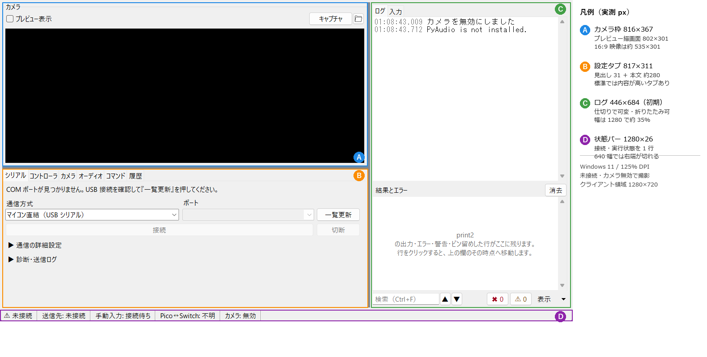
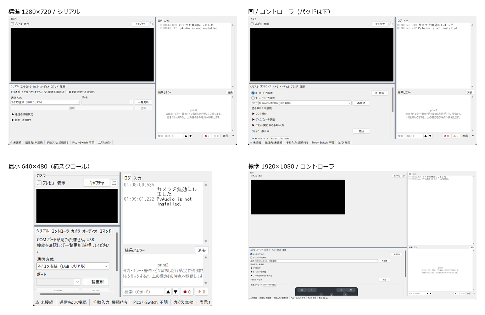

# 現行 UI レビュー用資料 — Poke-Controller Re: メイン画面

作成日: 2026-11-01 / 対象: `a515503`（`Moi-poke/レイアウトの修正`）/ Windows 11 / 実画面計測あり

この文書は、ローカルファイルを読めないチャット専用 AI に現行レイアウトをレビューしてもらうための自己完結した説明です。コードを読まなくても画面構成・寸法・表示条件・操作の流れが分かるように書いています。画像は末尾の一覧から添付してください。最短なら `00-annotated-1280.png`（全体の区画と寸法）と `00-contact-sheet.png`（主要 4 画面の一覧）の 2 枚で足ります。本文だけでもレビュー可能です。

**あなたへの依頼: 読み終えたら「8. レビューしてほしいこと」の 7 問に答えてください。**

関連資料: [`detail-ui-audit.md`](detail-ui-audit.md)（レイアウトではなく、文言・状態表示・自動化の監査）。

---

## 0. 最初に知っておいてほしいこと

- アプリは **Nintendo Switch の自動操作** を行う Windows 向けデスクトップアプリ（tkinter/ttk）。PC →（USB シリアル / Pico 中継）→ Switch にボタン入力を送り、キャプチャボードの映像をプレビューする。
- 日常の作業は **「接続する → 映像を見る → コマンドを選んで実行する / 手動で操作する → 止める」**。
- 画面は大きく 3 つ + 状態バー。
  - 左上: **カメラ（映像）**
  - 左下: **設定タブ**（シリアル / コントローラ / カメラ / オーディオ / コマンド / 履歴、BCON 使用時のみ BCON がシリアルの隣）
  - 右: **ログ**（ログ / 入力、上下 2 段）
  - 最下部: **状態バー**（接続・実行状態を 1 行）
- 既定は「標準」レイアウト + 「ログを右」+ プレビュー `fit`（ウィンドウに合わせる）。
- 直近で「状態 → 主要操作 → 詳細」の再構成、状態バーの新設、BCON のセクション化、入力調停のコントローラタブ移設は **すでに実施済み**。古いスクリーンショットや、別ブランチ（`UIの調整`）を前提にした指摘は現状と一致しない可能性がある。

---

## 1. レビューの前提（タスクと優先順位）

利用者の主な目的は次の順で、画面もこの順に読めることが期待されている。

1. **接続する**: 通信方式と COM ポートを選び、接続状態と失敗理由を知る。
2. **映像を見ながら操作する**: プレビューを見て、手動（キーボード / ゲームパッド / 仮想パッド）またはコマンドで操作する。
3. **コマンドを実行・停止する**: コマンドを選び、開始し、必要なら一時停止・停止する。
4. **結果とエラーを確認する**: ログ・実行履歴・診断を見る。
5. **複数台を同時に動かす**: プロファイルごとに別ウィンドウ。コンパクト / プレビューのみのレイアウト、プロファイル色帯で識別する。

制約:

- Switch 実機・キャプチャボード・マイコンはレビュー環境にない。今回の計測は **未接続・カメラ無効** の状態で行った。
- 画面は 3840×2160 / 125% 表示（Tk scaling 1.666）で、ウィンドウはクライアント領域 1280×720 を基本に計測した。画像はすべてクライアント領域のみ（メニューバーとタイトルバーは写っていない）。
- 既定の最小サイズは 640×480。コンパクト / プレビューのみでは 320×200 まで縮められる。

---

## 2. 全体構造（標準レイアウト / 1280×720）

### 2.1 実測した区画

| 区画 | 位置・大きさ (px) | 備考 |
|---|---|---|
| カメラ枠 | x=5, y=5, **816×367** | 見出し「カメラ」、上部にツールバー |
| 　プレビュー描画面 | カメラ枠内 x=12, y=64, **802×301** | 映像は 16:9 を保って中央に収まる（後述） |
| 設定タブ枠（ScrollHost） | x=5, y=378, **817×311** | タブ見出し約 31px + 本文約 280px（シリアル選択時） |
| ログ枠 | x=829, y=5, **446×684**（初期） | 仕切りで幅を変更可、比率は保存。非表示にもできる |
| 状態バー | x=0, y=694, **1280×26** | ウィンドウ下端に固定 |
| 区切り（sash） | 幅 6px | ドラッグで比率変更、メニューで既定位置に戻せる |



### 2.2 文字でのワイヤーフレーム（1280×720）

```
┌──────────────────────────────────────────────────────────────────────────┐
│ メニュー: ファイル(F) コマンド(C) 表示(V) 接続(N) ツール(T) ヘルプ(H)      │
├───────────────────────────────────────────────┬──────────────────────────┤
│ カメラ  [✓ プレビュー表示]      [キャプチャ][📁] │ ログ | 入力              │
│ ┌───────────────────────────────────────────┐ │ ┌──────────────────────┐ │
│ │                                           │ │ │ 01:02:18.642 ...     │ │
│ │            映像（16:9・中央）              │ │ │ （流れるログ）        │ │
│ │                                           │ │ │                      │ │
│ └───────────────────────────────────────────┘ │ ├──────────────────────┤ │
│                                               │ │ 結果とエラー     [消去]│ │
├───────────────────────────────────────────────┤ │ （残す行・警告・エラー）│ │
│ [シリアル][コントローラ][カメラ][オーディオ]   │ │                      │ │
│ [コマンド][履歴]  ← BCON 使用時はシリアルの隣  │ ├──────────────────────┤ │
│                                               │ │[検索][▲][▼][✖0][⚠0][表示]│
│  選択中タブの内容（ここではシリアル）          │ └──────────────────────┘ │
│                                               │                          │
├───────────────────────────────────────────────┴──────────────────────────┤
│ ⚠ 未接続 │ 送信先: 未接続 │ 手動入力: 接続待ち │ Pico↔Switch: 不明 │ …    │
└──────────────────────────────────────────────────────────────────────────┘
```

### 2.3 常時見えるもの / タブの中にしかないもの

| 常時見える | タブの中だけ |
|---|---|
| 映像プレビュー、プレビュー表示の入切、キャプチャ、保存フォルダ | 通信方式・COM ポートの選択、接続 / 切断、接続失敗理由 |
| ログ（ログ / 入力、結果とエラー、検索、表示メニュー） | キーボード / ゲームパッドの有効化、パッド選択、デッドゾーン、入力調停 |
| 状態バー（実行状態・送信先・手動入力・Pico↔Switch・カメラ・fps） | コマンド選択、開始 / 一時停止 / 停止、タグ絞り込み |
| メニュー（表示設定・レイアウト・接続・ツール） | 実行履歴、カメラ選択・フィルタ、オーディオ設定、BCON 設定 |

**注目点**: 標準レイアウトでは「コマンドの選択・開始・停止」が左下の「コマンド」タブを開かないと見えない。グローバルショートカット（F6 開始 / Esc 停止 / F7 一時停止 / Ctrl+K コマンド選択）とメニューには常時アクセスできる。映像を見たまま開始・停止する主要経路が、画面上のボタンとしては常設されていない。

---

## 3. 状態表示（状態バー / バッジ）

### 3.1 状態バーの項目

`表示(V) > 常時表示する項目` で個別にオン / オフでき、設定 `Window.status_items` に保存される。既定は 6 項目すべて。

| キー | 表示例 | 意味 |
|---|---|---|
| state | `■ 停止中` / `▶ コマンド名` / `⏸ コマンド名` / `⏳ 停止待ち 2秒` / `⚠ 未接続` / `ポート接続中` / `HELLO 確認中` / `接続失敗` | 実行・接続の最優先状態 |
| target | `送信先: COM3 / Pico 中継（別プロセス）` / `送信先: 未接続` / `送信先: 接続処理中` / `送信先: 接続失敗` | PC と送信機の接続 |
| input | `手動入力: 接続待ち` / `手動入力: 受付中（キーボード・パッド）` / `手動入力: 停止（コマンド実行中）` / `手動入力: 停止（入力なし）` | 手動入力の受付状態 |
| bcon | `Pico↔Switch: 有線` / `無線` / `不明` / `（更新停止）` | Pico と Switch のリンク（BCON 時） |
| camera | `カメラ: デバイス名` / `カメラ: 無効` / `カメラ: 開けません` | カメラ状態 |
| fps | `表示 59.8 fps` | 実測表示 fps |

状態バーは**全タブ共通の 1 行**で、タブを切り替えても接続状態が見える。色分けは標準レイアウトではなく、コンパクト / プレビューのみのときプレビューに付くバッジ（緑=実行中、橙=一時停止 / 停止待ち、赤=未接続 / 失敗、灰=待機）で行う。

### 3.2 接続状態の変化

- 未接続: `⚠ 未接続` / `送信先: 未接続` / `手動入力: 接続待ち`。
- 接続処理中: `ポート接続中` → `HELLO 確認中`。失敗すると `接続失敗` になり、シリアルタブに理由と「速度を探す」などの復旧ボタンが出る。
- 接続済み・待機: `■ 停止中`、送信先にポート名と通信方式の表示名。
- 実行中: `▶ コマンド名`、コマンドタブの「開始」ボタンは「停止」に変わる。
- 一時停止: `⏸ コマンド名`、ボタンは「再開」。
- 停止待ち: `⏳ 停止待ち N秒`（停止要求後、スレッドが終わるのを待っている）。

---

## 4. タブ別の内容（上から下、左から右の順）

タブ見出しの順: **シリアル →（BCON）→ コントローラ → カメラ → オーディオ → コマンド → 履歴**。BCON は通信方式が `switch-bcon` / `switch-bcon-proc` のときだけシリアルの隣に現れる。既定の通信方式は「マイコン直結（USB シリアル）」なので、通常の起動では BCON タブは出ない。

### 4.1 シリアル

```
[!] COM ポートが見つかりません。USB 接続を確認して『一覧更新』を押してください。  ← 失敗時だけ
通信方式
[ マイコン直結（USB シリアル） ▼ ]          （幅 389 / ウィンドウが狭いと下段へ）
ポート
[ COM3: USB シリアル デバイス ▼ ] [一覧更新]  （幅 294 + 98）
[            接続（幅 690）            ] [切断(98)]
（接続結果・失敗理由）                         ← 失敗時だけ
[速度を探す]                                  ← 失敗時だけ
▶ 通信の詳細設定                              ← 折りたたみ（既定は閉）
   通信速度 / 次回の接続: 9600bps / [9600 ▼][速度を探す]
   通信方式の説明（例: 従来と同じテキスト行を pyserial で送る）
▶ 診断・送信ログ                              ← 折りたたみ（既定は閉）
   選択: 未選択　実際: 不明 / 通信速度: 不明　HELLO: 対象外
   [ ] 送信内容を表示（ログ）
```

- 通信方式の候補は 3 つ: `マイコン直結（USB シリアル）` / `Pico 中継（USB）` / `Pico 中継（別プロセス）`。表示名は「PC↔Pico が USB か、Pico が Switch を中継するか」が分かる名前。
- 通信方式とポートは幅 470px 以上で左右 2 列、狭いと縦 2 段。接続失敗の理由は押したボタンの直下、詳細は折りたたみの中。
- 接続状態そのものはタブ内に常設せず、状態バーに出す（タブを開いていなくても見えるようにするため）。
- 「接続」は接続中に「再接続」へ変わる。切断は右側。
- 「速度を探す」は失敗時のみ。BCON 用の baud 探索。

### 4.2 コントローラ

```
[✓] キーボードで操作                         [キー割当]
[ ] ゲームパッドで操作
    ※ HidHide 未設定ならここに理由と [HidHide セットアップ]（未設定時のみ）
パッド [ 0: Pro Controller (HID直結) ▼ ] [再接続]
読み取り：未接続
▶ マウス操作                                  ← 折りたたみ（左/右スティックをマウスで）
▶ ゲームパッドの調整                          ← 折りたたみ
   スティックの遊び（0〜8192） [1638]
   大きくするほど、スティックの小さな傾きを無視します（既定 1638）。
▶ コマンド実行中の手動入力                    ← 折りたたみ
   入力調停 [ off ▼ ]
   どちらも断りません（本家と同じ挙動）。
ジャイロ  停止中                              [開始]
┌ 仮想コントローラ ────────────────────────── [別ウィンドウで開く] ┐
│ （埋め込みの操作盤。要求高さ約 300px）                          │
└──────────────────────────────────────────────────────────────┘
```

- 「コマンド実行中の手動入力」は以前シリアルタブにあった「入力調停」を移したもの。既定 `off` は本家と同じ（コマンド実行中の手操作を断らない）。
- ゲームパッドは HidHide 未設定だとチェック自体が無効になり、理由とセットアップ入口がその場に出る。
- 仮想コントローラはタブ内に常設だが、**タブ内容が高いため初期表示では見出しが下端に接する**。スクロールで全体を見る（コミット `a8d72fc` で「切る」から「スクロール」へ変更済み）。
- ジャイロ開始は操作盤の下ではなく、常に見える位置（`ジャイロ ... [開始]`）にも重複配置している（`ff1afef` / `28ec960`）。操作盤側にもジャイロ設定がある。

### 4.3 カメラ

```
使用するカメラ                               [再読み込み]
[ 0: Live Gamer EXTREME 3 [fbad85] ▼ ]        （幅いっぱい）
カメラ ID [ 0 ]                               ← 名前を取れない環境だけ
表示フィルタ
[ 使う ] [調整...]
```

- 映像を見る場所（カメラ枠）とは別に、**カメラの選択とフィルタはこのタブ**にある。
- カメラを開けないときは、カメラ枠のツールバーに赤字の理由と「カメラタブを開く」が出る。

### 4.4 オーディオ

```
入力                                         [再読み込み]
[ 入力デバイス ▼ ]                            （幅いっぱい）
出力
[ 出力デバイス ▼ ]                            （幅いっぱい）
[ ] モニター（入力を出力へ流す）
音量                                        80% (-1.9 dB)
[────────────●──────────────────────────────]
レベル  0.00   推定 in --＋out --
```

### 4.5 コマンド

```
[                                           ]  ← 検索欄（ラベル・プレースホルダなし）
[ すべて ▼ ] [タグ]                    [📁]
┌ Python コマンド | MCU コマンド ──────────────────────┐
│ [ A連打 ▼ ]                                          │
└──────────────────────────────────────────────────────┘
                                [再読み込み] [開始] [一時停止]
```

- 検索欄は入力すると即絞り込み。Enter で抜け、Esc で解除。
- コマンドのタブ（Python / MCU）を切り替えると、その一覧へ絞り込み直す。
- 実行中は「開始」が「停止」に変わる。一時停止は実行中だけ押せる。停止は Esc でも可能。
- 選択欄の上に検索・タグの段、下にボタン段。ボタンは右下寄せ。

### 4.6 履歴

```
検索 [                                   ] 0 件
┌ 実行履歴の表（Treeview） ──────────────────────────┐
│                                                    │
└────────────────────────────────────────────────────┘
[      実行      ] [      停止      ] [      選択      ]
[      削除      ] [          全消去          ]
```

- 検索、件数、表、空状態の説明、実行 / 停止 / 選択 / 削除 / 全消去。
- 空のときは「実行履歴はまだありません / コマンドタブで実行すると残ります」。

### 4.7 BCON（通信方式が bcon のときだけ）

2 列。幅が足りないときは 1 列へ並べ替える。

```
左列（操作）                         右列（状態・設定）
┌ 操作 ────────────────┐            ┌ コントローラ状態 ──────────────┐
│ [状態を更新][Switchへ再接続] │            │ プレイヤーLED  ■ ■ ■ ■          │
│ （失敗時のみ HELLO/速度探索） │            │ ジャイロ: なし / 振動: 未受信    │
└──────────────────────┘            └────────────────────────────────┘
▶ 接続モード・ペアリング                ▶ 本体色（RRGGBB）
   接続方式 [有線][無線][現在の方式]      4 色の入力 + プレビュー + [色を送る]
   種別 [Pro Con][Joy-Con L][Joy-Con R]
   [シリアルタブで接続し直す]
   ── 無線ペアリング（無線モードのみ）
   取込時間 [15] 秒 [取込開始]
   [保存した入力を再生]
▶ 通信診断・詳細ログ                    ▶ 保守（取り消せない操作）
   ポート/HELLO/STATUS, 実速度            [BOOTSEL再起動]
   [HELLO][PING][速度を探す] + ログ       [取込を破棄][ペア鍵を全削除]
```

- 左列は「操作」と「接続モード・ペアリング」、右列は「状態」「本体色」「通信診断」「保守」。既定で開いているのは「操作」と「コントローラ状態」だけ。
- 接続方式・種別を変えると Pico が再起動し COM ポートが外れる、という警告を操作の前に置いている。
- 取り消せない操作（BOOTSEL / 取込破棄 / ペア鍵削除）は最下部の「保守」に隔離。

---

## 5. レイアウトのバリエーション

### 5.1 全体レイアウト（表示(V) メニュー）

| レイアウト | タブ | ログ | カメラの操作部 | 下端の状態バー | プレビュー | 最小サイズ |
|---|---|---|---|---|---|---|
| 標準 | 出す | 出す | 出す | 出す | 表示設定に従う（既定 fit） | 640×480 |
| コンパクト（複数台向け） | 隠す | 隠す | 隠す | 隠す | 枠いっぱい、バッジ + 1 行バー | 320×200 |
| プレビューのみ | 隠す | 隠す | 隠す | 隠す | 枠いっぱい、バッジのみ | 320×200 |

コンパクトの 1 行バーは「色チップ / プロファイル名 / 状態 / [開始][一時停止][選択...]」を下端に置く。標準ではこのバーは出ない。

### 5.2 欄の並べ方（標準時のみ）

| 設定値 | メニュー名 | 形 |
|---|---|---|
| `log_right`（既定） | ログを右 | `H[ V[preview, tabs], log ]` |
| `log_bottom` | ログを下 | `V[ H[preview, tabs], log ]` |
| `side` | 右にタブとログ | `H[ preview, V[tabs, log] ]` |
| `stack` | 縦一列 | `V[ preview, tabs, log ]` |

- 仕切りはドラッグで動かせ、比率は保存される。表示(V) に「仕切りを既定の位置に戻す」がある。
- 表示(V) で「設定タブ」「ログ」を個別に折りたためる。プレビューは常に残る。
- ウィンドウ 1280×720 / 1920×1080 のプリセットと「16:9 に固定」がある。

---

## 6. 実測したレイアウト事実（レビューの材料）

### 6.1 プレビューは高さで頭打ちになり、横幅が余る

プレビューは 16:9 を保って枠に収まる（`fit`）。**映像の大きさを決めているのは高さ**で、横幅ではない。実測では、ログを非表示にするとプレビュー幅は 804→1256px に広がるが、映像は **535×301 のまま**。仕切りでログを 446→364px に狭めても、映像は 535×301 のままだった。

| ウィンドウ | プレビュー描画面 | 16:9 映像の実寸 | 横の余り |
|---|---|---|---|
| 1280×720 | 802×301 | 535×301 | 267px |
| 1600×900 | 1058×436 | 775×436 | 283px |
| 1920×1080 | 1314×571 | 1015×571 | 299px |

（表は 16:9 固定と描画面寸法からの計算値。実映像での確認は未実施。）

- 1280×720 では、縦 684px をカメラ枠 367、タブ 311、仕切り 6 で分け合う。映像は高さ 301 が上限になる。
- ログの幅は固定ではない。初期値は 446px（35%）だが、1600 で 512px（32%）、1920 で 576px（30%）。仕切りをドラッグすれば変えられ、比率は `Window.pane_sashes` に保存される。表示(V) で折りたたむこともできる。
- したがって「ログを削る／畳む」だけでは映像は大きくならない。主因は **映像とタブが縦の高さを分け合っていること**。

### 6.2 コントローラタブは 1280 でも 1920 でもスクロールが必要

| ウィンドウ | 設定タブ欄の高さ（見出し込み） | 本文の見える高さ | コントローラタブ内容の要求高さ | 結果 |
|---|---|---|---|---|
| 1280×720 | 約 311px | 約 280px | 約 635px | 約 355px はみ出す |
| 1920×1080 | 約 432px | 約 400px | 約 635px | 約 235px はみ出す |

- 1280×720 では、仮想コントローラの見出しがタブ下端（y≈675、表示下端 y≈689）にわずかに見えるだけ。操作盤本体はスクロールしないと見えない。
- 1920×1080 でも操作盤は上端の一部（肩ボタン付近）だけが見え、ほぼ全体がスクロールの先にある。
- これは「切れる」ではなく、`a8d72fc` で意図的に「スクロールで見せる」へ変えた結果。ただし、**初期表示で一番使う操作盤が見えない**ことは、情報の優先順位としてレビュー対象。
- ジャイロ開始だけは常設の近道（`ジャイロ [開始]`）で救っている。



### 6.3 640×480（最小サイズ）では横スクロールと見切れが出る

- 左のカメラ枠は 304×187、プレビュー描画面は約 290×121（映像は約 215×121）。右のログは 320×444 で、画面のほぼ半分を占める。
- 設定タブの見える幅は 304px だが、ノートブックの要求幅は 371px。このため **横スクロールバー**が出る。シリアルタブでは横スクロールバーが高さを食い、「接続 / 切断」の段が下に隠れて縦スクロールしないと押せない。タブ見出しも「コマンド」までで、「履歴」は横スクロールの先にある。
- 状態バーは 640px に収まらず、右端の項目（カメラ / fps）が切れる。折り返しや省略記号はない。
- 最小サイズまで縮める利用シーン（複数台を並べる）では、この横幅で「接続 / 切断」に届くことが重要。

### 6.4 ラベルと入力欄の揃え方が場所で違う

- シリアル / カメラは「ラベルを入力欄の上」、コントローラは「ラベルを入力欄の左」、BCON は「ラベルを左」と混在。
- 入力欄の幅も、通信方式 20 文字、ポート 16 文字、パッド 24 文字、カメラ・オーディオは幅いっぱい、と不統一。
- ボタンの高さはほぼ 30px だが、幅は 98 / 110 / 251 / 690 と大きく違う。主操作（接続）は幅 690 で強いが、副操作（切断）は 98 で同じ段に並ぶ。
- 余白は「枠線を消して見出しと余白でまとめる」方針に統一されている（SectionFrame / CollapsibleSection）。一方、コマンドタブの検索欄にはラベルもプレースホルダもなく、何の欄か分からない。

### 6.5 情報の位置

- 接続の「状態」は下端の状態バー、「操作」はシリアルタブの上、「失敗理由」はシリアルタブのボタン直下、「詳細」は折りたたみ。**1 つの接続タスクの情報が 3 か所に分かれる**。
- コマンドの「選択・開始・停止」はコマンドタブの中だけ。映像を見ながらボタンで開始・停止するにはタブを切り替える（またはショートカット）。
- ログは常時見えるが、コマンド実行の主操作より広い面積を持つ（1280 で 446×684）。

### 6.6 既存の配置プリセットの実測（1280×720）

| 配置 | 映像 | タブ欄 | ログ | コントローラタブ |
|---|---|---|---|---|
| `log_right`（既定） | 535×301 | 818×311 | 446×684 | 内容 約635 > 本文 約280 → **スクロール** |
| `log_bottom` | 544×306 | 506×372 | 1270×306（下） | 内容 約635 > 本文 約341 → **スクロール** |
| `side` | **724×407** | 526×345 | 526×333 | 内容 約617 > 表示 約314 → **スクロール** |
| `stack` | 208×117 | 1270×250 | 1270×239 | スクロール |

- `side` は既存の `H[preview, V[tabs, log]]`。**映像は現行の約 1.83 倍の面積**になり、ログも幅 526×高さ 333 を確保できる。Q1 の映像サイズはこれだけで改善する。
- ただし `side` は右列でタブとログが高さを分けるため、コントローラタブは依然スクロールする（右列タブの表示高さ 345、本文 314 に対し内容 617）。1920×1080 でも右列タブは 525 で、内容 635 には足りない。
- Q1 と Q4 を同時に満たすには、**タブを右列の上から下まで使う**新しい配置（`H[V[preview, 実行バー, log], tabs]`）が必要。ログは左列の映像下に来るため、高さは約 200px に減る。
- 仮想パッドの論理サイズは **420×170**。125% では **525×213** を要求する。`side` の右列 526px ではパッドは 480×195（scale 1.14 / 倍率 1.25 = 91%）で描かれ、読める。等倍を保つには右列 **約 545px** が必要。

---

## 7. 参考意見（GPT-6 Astra 案）と現行実装の対応

以下はユーザーが参考として貼った意見の要約と、**このコミット時点の実装**との比較。同氏の前提は別ブランチ（`UIの調整`）または古いスクリーンショットの可能性があり、現行ではすでに直っている項目がある。

| # | 参考意見 | 現行 | 判定 |
|---|---|---|---|
| 1 | 接続欄を「機器接続」にし、接続先・状態・接続/切断を中心に。通信方式は名前 + 説明、速度/HELLO は展開。 | シリアルタブは「通信方式 / ポート / 接続 / 切断」が中心。速度・説明・診断は折りたたみ。ただし接続状態はタブ内でなく下端の状態バー。 | 一部済み（配置は違う） |
| 1b | 「Switch 接続」欄を「Switch への接続方式」に。PC↔送信機と Switch の確認を区別し、未確認は「未確認」。 | 「Switch 接続」という欄は現行に存在しない。状態バーの `Pico↔Switch: 不明/有線/無線` が相当。失敗理由はシリアルタブ。 | 用語の前提が現行と不一致 |
| 2 | コントローラを「普段の操作 / 入力設定 / 診断」に整理。入力調停は「自動実行中の手動操作」として入力設定へ。 | 「キーボード / ゲームパッド」が操作、「マウス操作 / ゲームパッドの調整 / コマンド実行中の手動入力」が折りたたみ。**入力調停はすでにコントローラタブへ移動済み**。生の軸値や入力経路の診断欄はない。 | 一部済み、診断が未整備 |
| 2b | デッドゾーンは「1638」より「5%」を前面に。 | `スティックの遊び（0〜8192） [1638]` と注記。% 表示はない。 | 未対応 |
| 2c | 画面上のボタン点灯が「検出」か「送信」かを明確に。別窓のコントローラは活かす。 | 仮想パッドは別ウィンドウ / タブ埋め込みを切り替え可能。点灯の意味の説明は画面に出していない。 | 未対応 / 要検討 |
| 3 | BCON を「ペアリング / 有線・無線 / 診断 / 設定 / 保守」に分ける。主要操作を上、詳細は展開。 | すでに「操作」「接続モード・ペアリング」「コントローラ状態」「本体色」「通信診断・詳細ログ」「保守」に分割。 | ほぼ済み |
| 4 | 映像と操作を同時に。上部に接続先・状態、左に映像、右に手動/自動、下部に直近の結果。接続概要はタブ切替でも見える位置。停止は常に届く。狭いときは縦。 | 映像 + タブ + ログは同時に見える。接続概要は下端の状態バーで常時見える。停止は Esc / メニュー / コマンドタブ。ただし開始・停止ボタンは常設でなく、コントローラパッドは初期表示で見えない。狭いときの縦配置はない（640 で横スクロール）。 | 一部済み、構成は要検討 |
| 5 | ラベル位置・入力幅・余白・ボタン高さを揃える。長い情報は幅、数値は短く。枠線より余白。主操作に強弱。状態は色 + 文字。無効理由を添える。 | 枠線なし・余白でまとめる方針は統一。ラベル位置（上 / 左）、入力幅、ボタン幅は不統一。無効理由（HidHide）はその場に出す。 | 一部済み |
| 6 | 最初の改修範囲は「接続欄の整理、入力調停の移動、コントローラ設定と診断の折りたたみ」。 | 入力調停の移動と折りたたみは済み。接続欄は再構成済みだが、状態は状態バーへ分離。 | 大半済み |

---

## 8. レビューしてほしいこと（具体的な問い）

以下について、**現行のまま残すべき点 / 変えるべき点 / 優先順位**を、理由とともに答えてほしい。

1. **1280×720 の基本構成**: いまの「左に映像（上）+ タブ（下）、右にログ」は最適か。映像が 535×301 しか使えず、既定ではログが 446px を占める（仕切りで可変・非表示可）。既存の `side` では映像 724×407 になるが、コントローラタブは依然スクロールする（6.6）。映像を大きくするには、どの構成がよいか（例: 映像を 16:9 の枠にし、右に操作・コマンド、下にログ / ログを折りたたむ / タブを右へ）。
2. **接続タスクの情報の置き場所**: 接続状態を下端の状態バーに置く現行方針は妥当か。それとも接続ボタンの近くに「接続先 + 状態 + 次の操作」をまとめるべきか。両方に出すなら、どちらを主にするか。
3. **コマンド実行の常設操作**: 標準レイアウトで「選択・開始・停止」を常時見せるべきか。見せるならどこに置くか（状態バー / 映像の下 / 右カラム）。ショートカットとメニューだけで足りるか。
4. **コントローラタブ**: 635px の内容を 311px（1280）でスクロールする現状は許容か。仮想パッドを初期表示で見せるには、タブを分ける（操作 / 設定 / 診断）、パッドを別窓既定にする、右カラムへ出す、のどれがよいか。ジャイロの常設近道は残す前提でよいか。
5. **640×480**: 横スクロールと状態バーの見切れを許容するか。許容しないなら、ログを下へ送る / 右カラムを畳む / 最小サイズを上げる、のどれを選ぶか。
6. **見た目の統一**: ラベルを上に統一するか、左に統一するか。入力欄の幅とボタン幅の基準をどう決めるか。主操作（接続・開始）と副操作（切断・再読み込み）の強弱をどう付けるか。
7. **最初に直す 3 点**: 変更範囲を小さく保ちつつ、効果が大きい順に 3 つ挙げてほしい。既存の Tk/ttk と現在の状態管理（状態バー、折りたたみ、レイアウト切替）を壊さない前提で。

回答の形式:

- 「現状の良い点」「問題点（証拠となる寸法・画面位置つき）」「変更案（優先順位つき）」「変更しない方がよい点」の 4 段で。
- 可能なら、1280×720 のワイヤーフレーム（テキスト）を 1 枚添えてほしい。

---

## 9. 未確認・制約（レビュー時の注意）

- **実機接続・実映像での確認はしていない**。今回の画像は未接続・カメラ無効のプロファイルで、プレビューは灰色 / 黒のプレースホルダ。状態バーは「未接続 / カメラ: 無効」。
- 実行中・一時停止中・接続成功時の画面は撮っていない。状態文字列はコード上の定義（`core/status_view.py`）から記載した。
- ツールチップ、キーボードフォーカス順、Tab 移動、スクリーンリーダー、100% / 150% など他の DPI、macOS / Linux の見た目は未確認。
- 画像はクライアント領域のみで、ネイティブのメニューバー・タイトルバーは含まない。ウィンドウタイトルにはアプリ名・版・プロファイル・実行状態が出る。
- ログ欄の「PyAudio is not installed」「カメラを無効にしました」は計測用プロファイルの状態で、レイアウトの評価対象ではない。
- 参考意見が前提にしている `docs/images/main-window.png`（2026-10-29）は現行より古く、シリアルタブの項目構成が違う。現行の判断にはこの文書と添付画像を使うこと。

---

## 10. 添付画像（`docs/layout-review/images/`）

| ファイル | 内容 | 見てほしい点 |
|---|---|---|
| `00-annotated-1280.png` | 標準 1280×720 の区画 A〜D と実測寸法の凡例 | まずこれ 1 枚。映像・タブ・ログ・状態バーの比率 |
| `00-contact-sheet.png` | 標準 1280（シリアル / コントローラ）、最小 640、1920 の 4 面 | 2 枚目。広い / 狭い / 高いでの差 |
| `01-standard-1280-serial.png` | 標準 / 1280×720 / シリアルタブ / 初期状態 | 全体の比率、映像の余白、ログ幅、状態バー |
| `02-standard-1280-controller.png` | コントローラタブ | 仮想パッドが下端で切れ、スクロールが必要なこと |
| `03-standard-1280-camera.png` | カメラタブ | カメラ選択が映像の外にあること |
| `04-standard-1280-audio.png` | オーディオタブ | 入力欄の幅、レベル表示 |
| `05-standard-1280-command.png` | コマンドタブ | 検索欄が無ラベル、開始 / 一時停止が右下 |
| `06-standard-1280-history.png` | 履歴タブ | 表とボタン段、空状態 |
| `07-standard-1280-bcon.png` | BCON タブ（bcon 通信時） | 2 列構成、折りたたみの初期状態 |
| `08-standard-1920-controller.png` | 標準 / 1920×1080 / コントローラ | 1920 でもパッドが下へはみ出すこと |
| `09-standard-640-serial.png` | 標準 / 640×480 / シリアル | 横スクロール、接続 / 切断の段が下に隠れる、状態バーの切れ |
| `10-arrangement-log-bottom.png` | ログを下 | 映像 + タブ + ログの縦配置 |
| `11-arrangement-stack.png` | 縦一列 | 映像が小さいときの比率 |
| `12-compact-1280.png` | コンパクト | 1 行バーとバッジ（カメラ無効のため映像は空） |
| `13-preview-only-1280.png` | プレビューのみ | 最小構成 |
| `14-side-1280-controller.png` | 既存 `side` 配置 / 1280 / コントローラ | 映像は大きくなるが、右列でタブとログが高さを分けるためパッドはまだ下 |

---

## 11. 参考: 実装の対応ファイル（必要な場合だけ）

| 領域 | ファイル |
|---|---|
| 全体の組み立て | `SerialController/Window.py` |
| レイアウト適用・状態バー・バッジ | `SerialController/ui/layout_panel.py` |
| 仕切りの組み立て | `SerialController/ui/pane_layout.py` |
| レイアウト定義（標準 / コンパクト / プレビュー） | `SerialController/core/display_mode.py` |
| 配置プリセット | `SerialController/core/pane_arrangement.py` |
| 映像・カメラタブ | `SerialController/ui/camera_panel.py` |
| シリアル / コントローラ | `SerialController/ui/serial_panel.py` |
| コマンド | `SerialController/ui/command_panel.py` |
| ログ | `SerialController/ui/log_panel.py` / `log_view.py` |
| 仮想パッド | `SerialController/ui/controller_dock.py` / `controller_pad.py` |
| BCON | `SerialController/BconSetup.py` / `ui/bcon_panel.py` |
| 状態文字列 | `SerialController/core/status_view.py` |
