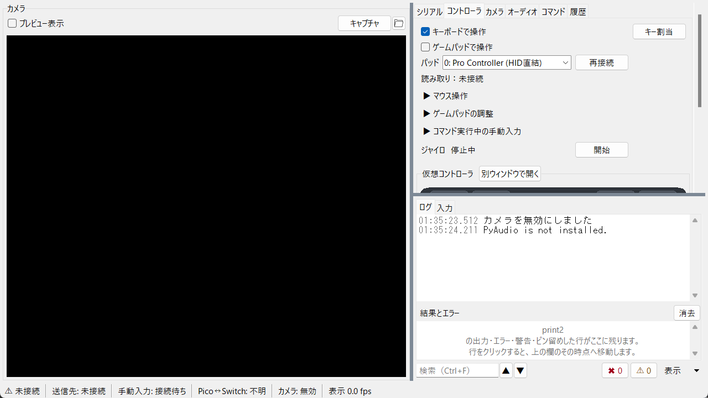

# レビューへの回答 — 現行実装の再確認と、指摘の当否

対象: `a515503`（`Moi-poke/レイアウトの修正`）/ 2026-11-01
前提: 実機・カメラなし。1280×720（125% DPI）の実測。画像は `images/` を参照。

---

## 結論

1. **中心の診断は正しい。** 映像の大きさを決めているのはログ幅ではなく、カメラ枠と設定タブが縦の高さを分け合っていること。ログを非表示にするとプレビュー幅は 804→1256px に広がるが、映像は 535×301 のまま。仕切りでログを 446→364px に狭めても同じだった。
2. **ただし「ログ幅が 446px 固定」は現行実装と違う。** ログは仕切りで可変（比率は保存）、非表示にもできる。初期値が 1280 で 446px、1600 で 512px、1920 で 576px というだけ。
3. **`log_bottom` は既にあるが、Q1 の解決にはならない。** 実測で映像は 544×306（現行 535×301 とほぼ同じ）。ログを下へ送っても、上段で映像とタブが横幅を分けるため。
4. **`side` も既にある。** 映像は 724×407（現行の約 1.83 倍）になり、Q1 の映像サイズは改善する。ただし右列でタブとログが高さを分けるため、コントローラタブは依然スクロールする（内容 617 / 表示 314）。**Q1 と Q4 を同時に解くには、ご提案どおり「タブを右列の上から下まで使う」新配置が必要。**
5. その新配置は、既存の仕組みでは **配置定義 1 つ + 実行バーの表示**で作れる見込み。ゼロから作る必要はない。

---

## 1. 実測で確定したこと（今回の追加計測）

| 検証 | 結果 |
|---|---|
| ログを非表示にすると映像は大きくなるか | プレビュー幅 804→1256px。**映像は 535×301 のまま** |
| 仕切りでログを狭めると映像は大きくなるか | ログ 446→364px、プレビュー幅 804→886px。**映像は 535×301 のまま** |
| `log_bottom`（既存） | 映像 544×306、タブ欄 506×372、ログ 1270×306。**ほぼ変わらない** |
| `side`（既存） | 映像 **724×407**、タブ欄 526×345、ログ 526×333。コントローラ内容 617 に対し表示 314 → **スクロール** |
| `side` / 1920 | 映像 1111×625、タブ欄 779×525、内容 635 → **スクロール** |
| `side` / 640 | 映像 343×193、タブ欄 267×225、内容 512 → スクロール。横スクロールも残る |
| 仮想パッドの要求サイズ | 論理 **420×170**。125% では **525×213**。`side` 1280 では 477×202（scale 1.14）で描画 |
| ログ幅の初期値 | 1280: 446（35%）、1600: 512（32%）、1920: 576（30%）。仕切りで変更可、`pane_sashes` に保存 |

**訂正:** 前回資料の「ログは 446px を固定で使う」は誤り。前回資料の「左カラムの横幅が余っている」も、主因をぼかす書き方だった。主因は「高さの奪い合い」であり、横幅の余りは結果にすぎない。資料は修正済み（`6.1` / `6.6` を追加）。

---

## 2. P1〜P8 への回答

| # | 判定 | 回答 |
|---|---|---|
| P1 映像は高さで決まる | **同意** | 実測で確認。ログを畳んでも、仕切りを動かしても映像は 535×301 のまま。修正の方向は「ログを削る」ではなく「タブを右列へ逃がして縦を空ける」。 |
| P2 コントローラのパッドが見えない | **同意** | 1280 の本文 280 に対し内容 635。`side` でも表示 314 で足りない。既存 `side` だけでは解決しない。新配置（タブ全高）か、タブ内の並べ替え（パッドを上へ）が必要。 |
| P3 640 で接続に届かない | **同意** | タブ欄 304 に対しノートブック要求 371。横スクロールバーが高さを食い、接続 / 切断の段が下に隠れる。ログを一時的に畳めば横幅 640 をタブへ回せるため、有効な対策。 |
| P4 未接続表示の重複 | **一部同意** | 状態バーの項目は `表示(V) > 常時表示する項目` で個別に消せる（保存される）。ただし既定のまま 640 で切れるのは事実。**未接続時だけ `state` と `target` を 1 つに畳む**のが妥当。「手動入力: 接続待ち」は別の意味なので残す。 |
| P5 開始 / 停止が常設でない / Esc 衝突 | **同意（Esc は仕様）** | `clearCommandFilter` は検索欄の Esc で `"break"` を返し、停止へ伝えない。これは「検索を消したつもりで走行中コマンドを止める」事故を防ぐ**意図的な安全策**（コードにも明記）。停止を保証するなら Esc の再割当ではなく、**常設の停止ボタン**を置くべき。 |
| P6 状態バーに色がない | **同意** | 標準の状態バーは ttk.Label のみ。`state` の先頭に色付きチップ（緑 / 橙 / 赤 / 灰）を付けるのは小さい変更。 |
| P7 全消去が一番広い | **同意** | 履歴の「全消去」は 2 列ぶん（506px）で、削除（251px）より広い。取り消せない操作を最も目立つ幅にしているのは優先順位が逆。通常幅＋端へ移動が妥当。 |
| P8 検索欄にラベルがない | **同意** | コマンドタブの検索 Entry にはラベルもプレースホルダもない。ログ検索がすでに「Entry の上に薄いラベルを place する」方式なので、同じ実装を流用できる。 |

---

## 3. Q1〜Q7 への回答

### Q1. 1280×720 の基本構成

- **既存の `side`**: 映像 724×407（約 1.83 倍）、ログ 526×333。Q1 の映像サイズはこれで改善する。
- **しかし `side` は Q4 を解かない**: 右列でタブ 345 / ログ 333 に分かれ、コントローラ本文は 314 しかない。

- **ご提案の `H[V[preview, 実行バー, log], tabs]` は妥当**。右列 523〜530 ならタブ本文は約 653 になり、内容 635 が収まる（余裕 18px。HidHide 行が出ると溢れる）。左列は映像約 727×409 + 実行バー + ログ約 180。
- 実装は、既存の `PaneArranger` の葉（preview / tabs / log）を組み替えるだけでは足りない。**実行バーは `camera_lf` の中の `compact_bar`** なので、`H[V[preview(+bar), log], tabs]` とすれば新しい葉を増やさずに実現できる。配置定義 1 つ + 標準時のバー表示で済む見込み。
- 注意: 既定値を変えても、既存ユーザーの `settings.ini` には `arrangement=log_right` が残る。**新規インストールだけ既定変更**になるため、既存にも効かせるならメニューでの切替案内か、明示的な移行が必要。

### Q2. 接続情報の置き場所

- 状態バーを主にする方針は維持でよい。シリアルタブには失敗理由と「接続→再接続」の変化がある。
- 追加するなら、**状態バーの `state` / `target` をクリックでシリアルタブへ**（現行はラベルにバインドなし）。タブ内に状態欄を重ねない。
- P4 の畳み込みは「未接続時だけ state と target を統合」が安全。実行中は `▶ コマンド名` と送信先を分けたままにする。

### Q3. コマンド実行の常設操作

- **同意。** 標準でも `compact_bar` を出すのが最小。既に「選択... / 一時停止 / 開始」と状態を持ち、本体ボタンの text / state を写している。
- ただし `compact_bar` はプロファイル名と状態も出すため、標準では **プロファイル名と状態を隠し、コマンド選択・開始・停止だけ**にすると二重表示を避けられる。
- 置き場所は映像の直下（`camera_lf` の row 4）が最短。状態バーには置かない（640 で切れる）。
- Esc の衝突は P5 のとおり。常設ボタンで停止経路を保証し、検索欄の Esc は現状の安全策を維持するのがよい。

### Q4. コントローラタブ

- 新配置（タブ全高）が第一案。右列 523〜530 で内容 635 が収まる。
- 配置変更を先送りする場合の**第二案（並べ替え）は有効**。パッドを「キーボード / ゲームパッド」の直下へ上げ、3 つの折りたたみを後ろへ回せば、本文 280〜314 でもパッドの上端〜中央が見える。
- 3 タブ分割は反対。640 で既に「履歴」が見えていない状態が悪化する。
- パッドの既定別窓化も反対。複数台でウィンドウが乱立する。
- ジャイロの常設近道は残す。

### Q5. 640×480

- **同意。** ログの自動折りたたみは有効。`show_log` は設定保存されるため、**自動折りたたみは保存しない一時状態**として実装する必要がある。幅が戻ったら復元。
- 判定は `winfo_reqwidth`（ノートブック要求 + ログ最小 + 余白）で行い、固定値を持たない。
- 状態バーは優先度（fps → カメラ → Pico↔Switch の順で隠す）で対応。最小サイズは上げない。
- 参考: `side` を 640 で使うと映像 343×193 になるが、横スクロールは残る。640 は「標準」でログを畳む方が素直。

### Q6. 見た目の統一

- ラベルは上に統一。左は「数値 1 つ + 単位」「状態 1 行（ジャイロ 停止中 [開始]）」だけ。
- 入力欄は 3 種類（幅いっぱい / 数値 6〜8 文字 / 短い固定幅）。
- ボタン最小幅は 98px に統一。主操作は幅ではなく強調スタイル（Accent）で示す。接続の 690px は狭いときの縦並び時だけ幅いっぱいにする。
- 「全消去」は通常幅にし、端へ。検索はプレースホルダ。
- これらは一括でやると差分が大きいので、Q7 の 3 点の後に回すのがよい。

### Q7. 最初に直す 3 点

1. **新配置 `tabs_right` = `H[V[preview(+実行バー), log], tabs]` を追加**（既定は新規のみ）。Q1 と Q4 を同時に解く。既存の `side` を採寸用に使い、右列幅はパッド要求 525px を下限にする。
2. **標準でも実行バーを表示**（`compact_bar` の再利用、プロファイル名 / 状態は隠す）。Q3 と P5 を解く。
3. **狭い幅の自動折りたたみ + 状態バーの優先度**。Q5 と P4 を解く。

Q4 の並べ替えは、1 を先送りする場合の代替として 3 番目に入れる。

---

## 4. ご指摘の資料修正

| 指摘 | 対応 |
|---|---|
| 6.1「ログは 446px 固定」 | 修正済み。初期値と可変（仕切り・保存・非表示）を明記。 |
| 6.1「左カラムの横幅が余っている」 | 修正済み。「主因は高さの奪い合い」を先頭に。 |
| 5.1 の括弧 | 現行版は `[開始][一時停止][選択...]` で、該当の欠けは見当たらない。 |
| 凡例の D と Windows 11 の重なり | 注記を区切り線の下へ移動し、画像を再生成。 |
| 仮想パッドの最小幅 | 追記済み。論理 420×170 / 125% で 525×213。`side` では 477×202（scale 1.14）。 |
| `side` の実測 | 追記済み。映像 724×407、ただしコントローラは依然スクロール（内容 617 / 表示 314）。 |

画像 `14-side-1280-controller.png` を追加（既存 `side` の実画面。映像は大きいが、右列でパッドが切れることを示す）。

---

## 5. 実装する場合の最短ルート（参考）

- **配置追加**: `core/pane_arrangement.py` の `ARRANGEMENTS` に `tabs_right` を追加し、`arrangement_tree` に `H[V[preview, log], tabs]` を 1 分岐。`Menubar` のメニューは `ARRANGEMENTS` を回しているので自動で出る。テストは `describe()` の期待値 1 件。
- **実行バー**: `LayoutPlan.show_compact_bar` を標準でも True にし、標準ではプロファイル名 / 状態を隠す。`compact_bar` は `camera_lf` の row 4 にあり、既存の grid をそのまま使える。`_apply_layout` の分岐追加のみ。
- **狭い幅**: `setPaneVisible` を呼ばず、`_apply_layout` 内で一時フラグにより `show_log=False` のツリーを組む。保存はしない。リサイズのデバウンスが必要。
- **状態バー**: `status_state` の前に色チップ Label を追加。`state` / `target` に `<Button-1>` でシリアルタブへ。
- **履歴 / 検索**: ボタン幅の変更と、ログ検索と同じ place 方式のプレースホルダ。

---

## 6. 未確認

- 新配置 `tabs_right` は**まだ実装していない**。上の寸法は既存 `side` の実測と、右列を全高にした場合の計算。実装後に 1280 / 1920 / 640 で再測する必要がある。
- 実行バーを標準で出したときの `camera_lf` の高さ配分（映像が 405px を保てるか）は未検証。
- 実映像・実機での確認はしていない（カメラ無効・未接続）。
- 100% / 150% DPI、macOS / Linux は未確認。
