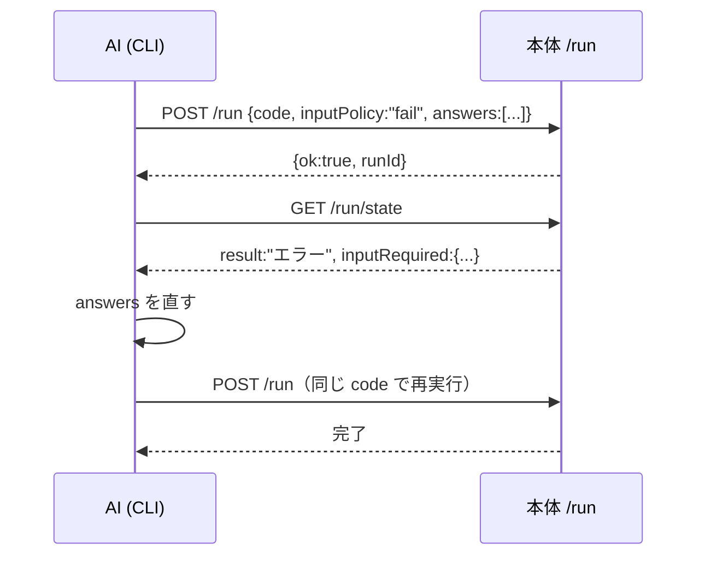

# Blockly 実行時選択（アイコン付きギャラリー）と AI 入力チャネル設計

Status: 設計（未実装） 2026-11-02.

対象: 実行時に「このアイテムだけ」を選ばせる UI と、それを外部 AI から人間の
ダイアログ操作なしに走らせるための入力チャネル。既存の設定ブロック
（`pokecon_dialog_choice` 等）は残し、加算的に足す。

## 1. 目的

1. 実行開始時に、対象（アイテム等）を**引数として GUI で指定**できる。
   常設パネルではなく、Start 直後に1回だけ出るダイアログ。選択肢には
   **分かりやすいアイコン**を付けられる。
2. アイコンは**表示専用**。画像認識のテンプレートとは独立に指定できる
   （認識に使わない画像を選べてよい）。
3. 同じスクリプトを**外部 AI が無人で走らせられる**。選択が必要な箇所は
   API から値を与え、人間のダイアログを開かせない。
4. 既存の保存物・実行経路・配布形式（manifest v0）を壊さない。

## 2. 非目標

- 画像認識テンプレートの動的指定（別設計。ギャラリーの値と組み合わせるのは将来）。
- 保存済みコマンドを AI から起動する API（AI が使えるのは従来どおり試し実行のみ）。
- 選択内容の永続記憶（前回値の復元）。
- アイコンの自動生成・アニメーション。
- 複数選択を汎用リスト機能へ広げること（必要な最小の 2 ブロックだけ足す）。

## 3. 現状（設計の前提）

- 入力ダイアログの入口は `Commands/CommandDialog.py` の `DialogMixin.dialogue` /
  `dialogue6widget`。`PokeConDialogue`（同ファイル）が mode1 で
  `check/combo/entry/colorentry/radio/spin/scale` の 7 種を組む。
- 戻り値は `ret_value(need)`。`need=list` は widget ごとの値の列、`need=dict` は
  ラベル→値。`ok_command` は `[v.get() for v in dialogue_ls.values()]` なので、
  `.get()` が list を返す変数を入れれば複数選択も既存契約に収まる。
- 設定ブロックの生成は `assets/blockly/pokecon_blocks.js` の
  `dialogAssign` / `pythonGenerator.forBlock["pokecon_dialog_*"]`。取消は
  `self.finish()`。
- 試し実行は `services/blockly_run.py` の `build_trial_class` が
  生成クラスを包み、`ui/blockly_editor.py` の `POST /run` が開始する。
  `GET /run/state` が `TrialSession.snapshot()` を返す。
- テンプレ候補は `services/blockly_templates.list_image_templates` が
  `Template/` 以下を全部返し、`/templates`（編集画面）と検証の両方が使う。
- 配布 zip は `Template/<rel>` しか運ばない（`services/script_pack.install_zip`、
  `core/pack_manifest`）。`templates` は manifest に列挙する。
- vendored Blockly 13.2.1 の `blockly_compressed.js` には
  **`field_multilinetext` が入っていない**（`grep -io multiline` で確認）。
  複数行の欄は使えない前提で設計する。

## 4. 設計

### 4.1 ギャラリー widget（Tk）

`dialogue6widget` の mode1 要素として `gallery` を追加する。

```python
["gallery", "項目", [
    ("potion", "ポーション",       "mypack/icons/potion.png"),
    ("ball",   "モンスターボール", "mypack/icons/ball.png"),
    ("revive", "げんきのかけら",   ""),   # 空 = Template/<値> を自動で使う
], "potion", {"multi": False, "thumb": 40}]
```

- 要素: `(値, 表示名, アイコンパス)` の 3 つ組。値は任意の文字列。表示名と
  アイコンは表示専用。アイコンが空なら `Template/<値>` が実在するときだけ使う。
- 戻り値（既存 `_ls` の1要素として）:
  - 単一: `str`（例 `"potion"`）。既存 combo と同じ型なので `logic_compare` で分岐できる。
  - 複数: `list[str]`（項目の並び順に正規化）。
  - 取消: 全体が `None` → 生成コードが `finish()`。
- `need=dict` では `{"項目": "potion"}` / `{"項目": ["potion", "ball"]}`。
- 既定: 単一は `DEFAULT` の値を初期選択。複数はカンマ区切り、空 = 未選択、
  `*` = 全選択。
- 選択専用（combo と違い自由入力不可）。候補外の文字列は返らない。
- 12 件超で検索欄を出す（表示名・値の部分一致、空白区切りの全語）。
- キー: ↑↓/Home/End で移動、Ctrl/Shift で複数選択、Enter で OK、
  Esc で Cancel、ダブルクリックで OK。
- 停止: 既存 `_runDialogue` の `_stop_event` 監視・`_DIALOGUE_OPEN_TIMEOUT` を
  そのまま使う。ダイアログが開いた後の待ちは従来どおり利用者次第。

実装方針:

- `ttk.Treeview(show="tree", selectmode="browse"|"extended")` を使う
  （`image=`、スクロール、キー操作、複数選択が標準で付く）。
  `ttk.Style` の派生スタイルで `rowheight = thumb + 12`。
- `PhotoImage` は参照を保持しないと消える。ダイアログのインスタンスに
  `self._thumbs` で持つ。
- 画像の復号は **`np.fromfile` + `cv2.imdecode`**。`cv2.imread` は Windows の
  非 ASCII パスで失敗するため使わない。アスペクト比を保って `thumb` に収め、
  `cv2.imencode(".png")` の bytes を `PhotoImage(data=...)` に渡す。
- 大量時のために、項目の生成は `after` で 20 件ずつに分ける。ダイアログは
  `wait_window` でイベントループが回るため、分割生成できる。
- 文字だけの項目（アイコン無し）は画像なしで並べる。**欠落は実行を止めない**。

### 4.2 アイコンの置き場所・解決・配布

- 置き場所は `Template/<パッケージ名>/icons/*.png`。`Template/` 相対で
  `mypack/icons/potion.png` と書く（認識テンプレートと同じ基準）。
- `list_image_templates` はパス要素に `icons` を含む画像を**除外**する
  （1 箇所直せば `/templates`・検証・`catalog` すべてに効く）。
  アイコン一覧は別関数 `list_gallery_icons()` が返す。
- 解決順: 明示アイコン → `Template/<値>` が実在すればそれ → 文字だけ。
- パス検査: 絶対パス・`..`・`Template/` 外は拒否（`script_pack._confined_path`
  と同方向）。アイコンは装飾なので、**保存時は警告**（error にしない）。
- 配布: manifest の `templates` に `mypack/icons/*.png` を列挙すれば現行 v0 の
  まま運べる（形式変更なし）。列挙漏れの実害は「文字だけになる」に留める。
- 画像の受け渡しは既存の `/template_image?name=...` を再利用できる
  （`Template/` 内の閉じ込め検査はそのまま）。アイコン候補の一覧だけ
  `/icons` を新設する（ブロック側のアイコン選択 UI 用。後述）。

### 4.3 Blockly ブロック

> 改訂: v1 は §10.3 のクラス属性 `POKECON_INPUTS` と、§12 の**開始時引数
> ダイアログ**を採る。`do()` の中では入力しない。以下の「ギャラリー文ブロック」
> 案は採らない（UI は `choice` / `collect` widget として残す）。

#### 4.3.1 `pokecon_dialog_gallery`（文）

- fields: `VAR` / `TITLE` / `LABEL` / `ITEMS` / `MULTI` / `DEFAULT`。
- `ITEMS` は `field_input`（複数行欄が使えないため）に
  `値|表示名|アイコン` を `;` 区切りで書く。
  例: `potion|ポーション|mypack/icons/potion.png;ball|モンスターボール|mypack/icons/ball.png`
  `;` `|` は値・表示名・アイコンに使えない（保存時に error）。
- `MULTI` は `field_checkbox`。`DEFAULT` は値（複数ならカンマ区切り、`*`=全部）。
- 生成コード（単一）:

```python
item = self.dialogue6widget("狙うアイテム", [["gallery", "項目", [("potion", "ポーション", "mypack/icons/potion.png"), ("ball", "モンスターボール", "mypack/icons/ball.png")], "potion"]])
if item is None:
    self.print2("取り消しました。")
    self.finish()
    item = []
else:
    item = item[0]
```

- 複数は `{"multi": True}` を付け、`item = item[0]` の結果が `list[str]` になる。
- 文の位置は `do()` の先頭に置く前提（既存の設定ブロックと同じ。実行開始直後に出る）。

#### 4.3.2 複数選択の消費（2 ブロック）

道具箱には `lists_*` が無い（`editor.html` の 計算・論理 は `text_join` まで）。
ギャラリーの `list[str]` を扱う最小の 2 つを足す。

| ブロック | 形 | 生成 |
| --- | --- | --- |
| `pokecon_for_each` | 選択ごとに `変数` を `一覧` から | `for it in <list>:` |
| `pokecon_selected_has` | 選択に `値` を含む（Boolean） | `<value> in <list>` |

どちらも `spec.md` の操作表・`blockly_validate`・カタログに載せる。
単一選択だけなら不要なので、フェーズ 3 で足す。

#### 4.3.3 アイコン選択 UI（フェーズ 3・任意）

`ITEMS` は v1 では手入力。フェーズ 3 で `field_gallery_items`（独自欄）を
作り、`/icons` の一覧からサムネイルで選ぶ小さな表を出す。既存
`TemplateField`（`pokecon_blocks.js`）の作りを流用できる。

### 4.4 検証（保存前・問題欄・CLI）

`core/blockly_validate.py` に追加:

- `_DIALOG_BLOCKS` に `pokecon_dialog_gallery` を追加（受け変数名の検査を流用）。
- `ITEMS` の構文検査: 3 列（2 列目・3 列目は省略可）、空の値、値の重複、
  `;` `|` の混入、件数上限（100）。
- `DEFAULT` が項目に含まれるか（複数はカンマ区切り・`*` を許す）。
- 同じ `dialogue6widget` 呼び出し内の**ラベル重複**を error にする
  （現状 `dialogue_ls` がラベル辞書なので後勝ちで壊れる。既存の潜在バグも塞ぐ）。
- アイコンの実在・`Template/` 外・絶対パスは warn。

`services/blockly_author.py` / `references/spec.md`:

```json
{"dialog_gallery": {
  "var": "item",
  "title": "狙うアイテム",
  "label": "項目",
  "items": [
    {"value": "potion", "label": "ポーション", "icon": "mypack/icons/potion.png"},
    {"value": "ball",   "label": "モンスターボール", "icon": "mypack/icons/ball.png"}
  ],
  "multi": false,
  "default": "potion"
}}
```

- `catalog --format json` の `pokecon_dialog_gallery` に fields を出し、
  ルートに `icons`（`list_gallery_icons()` の一覧）を追加する。Markdown 版にも
  アイコン一覧を出す。

### 4.5 AI 入力チャネル（無人実行）

> 改訂: 答えの照合はラベルではなく `key` にし、**実行中には聞かない**（§10.4・§12）。
> 以下は初版の案（履歴として残す）。

AI が使える実行は試し実行（`POST /run`）だけ。ここに「選択の答え」を渡す。

#### 4.5.1 リクエスト

```json
{
  "code": "...",
  "maxSeconds": 120,
  "inputPolicy": "fail",
  "answers": [
    {"title": "狙うアイテム", "label": "項目", "value": "potion"},
    {"label": "確認", "value": true}
  ]
}
```

- `inputPolicy`:
  - `dialog`（既定、現行互換）: ダイアログを開く。人間のブラウザ試行はこれ。
  - `fail`: 未回答の入力に当たったらダイアログを開かず、実行を止めて
    `inputRequired` を返す。AI 用の既定。
  - `default`: 各 widget の既定値で進む（ダイアログを開かない）。
- `answers` の一致: `title`+`label` があればそれ、無ければ `label` のみ。
  1 つの答えは 1 回だけ消費する。同じ呼び出し内でラベルは一意（4.4 で担保）。
- 値の型: `combo`/`gallery` 単一 = str、`gallery` 複数 = `list[str]`、
  `check` = bool、`spin`/`number` = int、`scale` = float、`entry` = str。
  `gallery` は項目に無い値・未知のラベルを error にする（黙って捨てない）。
- 一部だけ回答がある場合、`dialog` では残りをダイアログで聞く
  （回答済みは初期値として入れる）。`fail` では未回答の先頭で止める。

#### 4.5.2 実装点

- `TrialSession` に `answers` / `used_answers` / `unused_answers` /
  `input_policy` / `input_required` / `used_defaults` を追加。
- `build_trial_class` が返す試し実行用クラスで `dialogue` と
  `dialogue6widget` を上書きする。生成コードは `self.dialogue6widget` を
  呼ぶので、ここ 1 箇所で全ブロックに効く。
  1. その呼び出しの全 widget に答えがある → 既存の戻り値の形で返す。
  2. `fail` で欠けている → `InputRequired`（内部例外）を投げる。
  3. `default` → 各 widget の既定値で返す。
  4. `dialog` → ベース実装へ（現行どおり人間が答える）。
- `InputRequired` は `do` の wrapper で専用に拾い、`session.input_required`
  に構造を残して `result="エラー"`・`error="入力が必要です: …"` にする。
  GUI 側の見え方は従来のエラーと同じで、新しい result 種別は増やさない。
- 実行前に**静的に分かる入力**は `/run` の受付時に検証する
  （`core/dialog_specs.py` が生成コードの `self.dialogue6widget(...)` /
  `self.dialogue(...)` を AST で読み、リテラル仕様なら一覧化する）。
  未知のラベル・候補外の値は開始前に断り、無駄な実行をしない。
  仕様が動的な呼び出しは `dynamic: true` として一覧に残す。

#### 4.5.3 `/run/state` の追加

```json
{
  "inputPolicy": "fail",
  "inputRequired": {
    "title": "狙うアイテム", "label": "項目", "kind": "gallery",
    "options": ["potion", "ball"], "default": "potion", "index": 0
  },
  "unusedAnswers": ["項目2"],
  "usedDefaults": []
}
```

AI のループ:



試し実行は履歴に残らず再実行が安いため、v1 は「止めて答えを直して再実行」で
足りる。長時間のコマンドで途中の入力に答えたくなったら、フェーズ 4 で
`pendingInput` + `POST /run/input` を足す（本設計の範囲外）。

#### 4.5.4 CLI（`tools/blockly_agent.py`）

- `check` / `render` の結果に `inputs`（静的入力の一覧）を追加する。
  AI は実行前に答えを用意できる。
- `trial` に `--answers <file>` と `--input-policy fail|dialog` を追加する。
  `--answers` を使うときの既定は `fail`。ファイル形式はリクエストと同じ。
- `inputRequired` で止まった場合は終了コード 1 とし、JSON に
  `status:"input_required"` と `inputRequired` を出す（クラッシュと区別できる）。
- 安全: 既存の Host / Origin / Content-Type 検査の内側。answers はデータで、
  コード実行には関与しない（検証済みの値だけを widget に渡す）。

### 4.6 生成コードの例（複数選択・フェーズ 3）

```python
items = self.dialogue6widget("狙うアイテム", [["gallery", "項目", [("potion", "ポーション", ""), ("ball", "モンスターボール", "")], "potion", {"multi": True}]])
if items is None:
    self.print2("取り消しました。")
    self.finish()
    items = []
else:
    items = items[0]
for target in items:
    if target == "potion":
        self.press("A", 0.1, 0.2)
```

## 5. 変更点の一覧

| ファイル | 変更 |
| --- | --- |
| `SerialController/core/dialog_gallery.py`（新規） | ITEMS 行の解析、アイコン解決（閉じ込め）、サムネ生成、型変換。tkinter 非依存 |
| `SerialController/core/dialog_specs.py`（新規） | 生成コードから静的入力仕様を AST で取り出す |
| `SerialController/Commands/CommandDialog.py` | `PokeConDialogue.mode1` に `gallery`、複数選択用の値オブジェクト、検索欄、分割描画 |
| `SerialController/assets/blockly/pokecon_blocks.js` | `pokecon_dialog_gallery`、`pokecon_for_each`、`pokecon_selected_has` と生成器 |
| `SerialController/assets/blockly/editor.html` | 道具箱 入出力 にギャラリー、流れ に for-each、計算・論理 に contains |
| `SerialController/core/blockly_validate.py` | `_DIALOG_BLOCKS` 追加、ITEMS/DEFAULT/ラベル重複/アイコンの検査 |
| `SerialController/services/blockly_templates.py` | `icons` 除外、`list_gallery_icons()` |
| `SerialController/services/blockly_author.py` | `dialog_gallery` 仕様の解釈、カタログに icons、検証呼出 |
| `SerialController/services/blockly_run.py` | `TrialSession` に answers/progress、開始前の入力解決（`build_trial_class` は入力ダイアログを触らない） |
| `SerialController/ui/blockly_editor.py` | `/run` の answers/inputPolicy、`/run/state` の追加項目、`/icons` ルート |
| `tools/blockly_agent.py` | `check`/`render` の `inputs`、`trial --answers` |
| `docs/blockly-agent/references/spec.md` / `cli.md` / `blocks.md` | 新ブロック・操作・CLI 契約 |
| `docs/BLOCKLY_EDITOR.md` / `docs/AI_AUTOMATION.md` | 利用者向け説明と AI 手順 |
| `tests/` | 下記 |

## 6. テスト計画

- `core/dialog_gallery.py`: ITEMS 解析（2/3 列・不正文字・重複）、アイコン解決
  （明示・自動・欠落・Template 外・絶対パス）、型変換、サムネ寸法。GUI 不要。
- `core/dialog_specs.py`: リテラル仕様の抽出、動的呼び出しの `dynamic` 化。
- `core/blockly_validate.py`: 新規ブロックの error/warn（ラベル重複を含む）。
- 生成: `tests/blockly_node.py` で Blockly を読み、`pokecon_dialog_gallery` →
  期待する構造のコード（単一・複数・既定・取消）。
- 実行器: `tests/test_blockly_run.py` 系に、answers 一致・型変換・`fail` の
  `inputRequired`・`default`・未使用 answers の報告を追加。
- 受け口: `tests/test_blockly_run_server.py` に answers/inputPolicy の受理と
  開始前検証（未知ラベル・候補外）を追加。
- 実画面: Tk のギャラリーは GUI 依存のため、`gui-probe` で 1 回確認する
  （検索・複数選択・アイコン欠落・キャンセル・停止）。
- ゲート: `task ci`（ruff / format / mypy / bounds / userapi / docs / test）。
  `[INFERENCE]` 実機 COM ポートでの試し実行は未確認として報告する。

## 7. 実装順

| フェーズ | 内容 | 受入 |
| --- | --- | --- |
| 0 | 本文書を確定し、未決事項を決める | 設計合意 |
| 1 | `core/dialog_gallery` + widget（単一選択・アイコン・検索・停止） | 実画面で選べる。取消で `finish()`。既存ダイアログに影響なし |
| 2 | `pokecon_dialog_gallery` + 検証 + spec/catalog + ドキュメント | 保存・再編集・生成が通り、問題欄が正しい |
| 3 | 複数選択 + `for_each` / `selected_has` + アイコン選択 UI | 選んだ複数を順に処理できる |
| 4 | AI answers（`/run`・`/run/state`・CLI `--answers`・静的 `inputs`） | 無人で最後まで走る。未回答は `inputRequired` で即止まる（ハングしない） |
| 5 | 配布（icons の manifest 列挙・除外の確認）と実機確認 | 別プロファイルへ配布してアイコンが出る |

フェーズ 4 は 2 の後なら 3 と並行できる。1 と 2 の間でブロックを先に置くと
生成コードが widget 未実装で失敗するため、1 → 2 の順を守る。

## 8. リスクと代替案

- **Tk のサムネ生成で固まる**: 大量画像を一括復号すると GUI が止まる。
  `after` で分割し、まず文字だけ並べて後から画像を差す。
- **非 ASCII パス**: `cv2.imread` は Windows で失敗する。`np.fromfile` +
  `cv2.imdecode` を必須にする。
- **`Template/` の汚染**: 除外を忘れると画像認識の候補にアイコンが混ざる。
  `list_image_templates` の 1 箇所で除外し、テストで固定する。
- **ラベル重複の潜在バグ**: 既存 `dialogue_ls` は同名ラベルを上書きする。
  新ブロックだけでなく既存 3 ブロックにも検証を効かせる。
- **無人実行のハング**: `dialog` のまま AI が走らせると無期限に待つ。
  `trial` の既定を `fail` にし、`fail` ではダイアログを開かない。
- **途中で入力が必要になる動的コマンド**: `fail` では実行の途中で止まる
  （ハードは直前の操作のまま）。静的に分かる入力は開始前に検証し、
  動的なものは `dynamic:true` として報告する。必要ならフェーズ 4 で
  `pendingInput` + `/run/input` を足す。
- **複数選択の表現**: 汎用リストを足すと Blockly の仕様・検証・CLI が広がる。
  ギャラリーの戻り値だけを扱う 2 ブロックに限定する。
- **アイコンの配布漏れ**: manifest 列挙が漏れると文字だけになる（実行は成功）。
  保存時の警告と配布ドキュメントで知らせる。
- **`field_multilinetext` が無い**: 単一行の `field_input` ＋ `;`/`|` 区切りで
  始める。使い勝手が悪ければ独自欄（フェーズ 3）へ。

## 9. 未決事項

1. アイコンの置き場を `Template/<pkg>/icons/` に固定するか、専用ルート
   （`Icons/` + manifest v1）にするか。本設計は前者（形式変更なし）を推す。
2. 複数選択の既定値の書き方（空 = 未選択 / `*` = 全部）でよいか。
3. 一覧 UI を 1 列リストにするか、アイコンのグリッドにするか
   （v1 は Treeview 1 列、必要ならグリッド）。
4. `/run/input`（実行中の入力応答）を v1 に入れるか、再実行ループで足りるか。
5. ブロック名を `pokecon_dialog_gallery` にするか
   （CLI の操作名 `dialog_gallery` と揃える）。

## 10. 改訂: Opus 5.5 案との比較と統合（2026-11-02）

結論: **土台は本設計（§1 の要件を落とさない）。Opus 案からは「入力の宣言と答えの
契約」だけを採る。** Opus 案は要件の一部（アイコンは認識テンプレートと独立）を
落としており、また「対象を選ぶ」を「全テンプレートを照合して集める」という
別機能へ広げている。v1 はそこまで含めない。

### 10.1 採用する（Opus 案が優れる点）

1. **入力仕様（`POKECON_INPUTS`）をクラス属性に1回だけ出す。**
   GUI は Start 直前にこれを読み、引数ダイアログを1回出す。答えは `key` で
   受け、`do()` 開始前に確定する。ダイアログ呼び出しからラベルを推測する案
   （§4.5）より、検証・AI・型変換のすべてが単純になる。
2. **`key` ごとの型を固定する。** choice 単一 = str、複数 = `list[str]`
   （セット順）、int = int。answers の未知キー・候補外の値は開始前に error。
3. **答えの出どころを1回で決める。** `answers` → `dialog` / `default` / `fail`。
   実行途中の入力 API（pending）は v1 では作らない。
4. **入力の確定を `do()` の最初に置く。** 未回答で `fail` したとき、
   ハードウェアに何も送らない。保存時にも「入力宣言より前に文がある」形を
   作らない（生成器が先頭へ寄せる）。
5. **選択肢セットをフォルダから作る。** `Template/<pkg>/<set>/*.png` の
   ファイル名（拡張子なし）を値にする。表の編集 UI を作らずに済む。
6. **複数選択が空のまま OK できない。** 既定 `*` は全選択。
7. **進捗の残りは後処理で必ず出す。** 停止・正常終了の両方で
   `finally` から `progress.remaining` を報告する。
8. **識別に margin を入れる（後続フェーズ）。** 1位と2位のテンプレートスコア差が
   小さいときは `None`。ROI がテンプレートより小さい場合は保存時に error
   （実行時は既存 `_checkTemplate` が `ValueError` にする。
   `core/CommandVision.py:401`）。

### 10.2 採用しない（Opus 案の誤り・過剰）

- **アイコン＝認識テンプレートに固定する（R1）。** 要件「アイコンは表示専用、
  認識に使わない」と矛盾する。**採らない。** ただしアイコン専用ストアは作らず、
  `Template/<pkg>/<set>/icons/<値>.png` の**規約**にする（API も manifest 拡張も
  不要）。無ければテンプレート画像をサムネイルに使う。
- ~~**`choice_identify` / `choice_remove` / `choice_count` / `choice_each` を
  v1 に入れる。** これは「選ぶ」ではなく「選んだ対象を自動で探して集める」
  別機能。v1 は選択と分岐まで。識別は後続（§10.5 のフェーズ 6）。~~
  **訂正（§11）**: 利用者の本命要件は「指定数入手の自動周回」なので、
  収集ループと識別は v1 の中心へ昇格する。ここでの「別機能」という位置づけは
  取り下げる（アイコンを認識に使わない点は維持）。
- **既存ダイアログのブローカー化をやめる、という指摘（R2/R5）。** 本設計は
  既存の `dialogue6widget` を置き換えず、widget 種別を1つ足すだけ。
  `DialogMixin._runDialogue` の GUI スレッド委譲・停止監視をそのまま使える。
  専用ダイアログを別に作ると、この繊細な待ちを二重実装することになる。
- **「先に答えたほうを採用」という競合（R2）や「宣言はコンテナ内だけ」（R3）は
  本設計に存在しない。** 答えの出どころはポリシーで1回に固定する。
- **`InputRequired` を「`except Exception` で捕まらない」例外にする。**
  そもそも v1 は実行中の入力を行わない（開始時に確定する）ため、この例外は
  不要。なお `StopThread` は `Exception` の派生（`core/CommandOperate.py:43`）
  なので「Exception で捕まらない」という前提も誤り。
- **表示名の対応表の置き場所が未定義。** 現行の配布は `Template/` の画像しか
  運ばない（`services/script_pack.py:405`）。対応表をファイルにすると v1 の
  manifest 拡張が要る。v1 は「表示名＝ファイル名（stem）」＋ブロック内の
  任意の対応表（SPEC に埋め込む）に限る。
- **`threshold=0.85`, `margin=0.05` を既定にする。** 既存の画像認識の既定は
  0.7。実キャプチャで較正するまで製品既定にしない（フェーズ 6 の受入で測る）。
- **`ChoiceList` の静的型検査。** Blockly の変数は型推論できず、一般には
  判定不能。直接配線のときだけ検査し、実行時にも型を確かめて明確なエラーに
  する、が現実的。
- **全テンプレート照合の性能見積りが無い。** セット全件 × 毎フレームは重い。
  ROI・照合間隔・テンプレートのプリロード/キャッシュ・セット件数上限を
  フェーズ 6 の設計に必須にする。

### 10.3 統合した v1 仕様

#### 引数の宣言（クラス属性）

```python
class BlocklyCmd(ImageProcPythonCommand):
    NAME = "..."
    POKECON_INPUTS = {
        "inputs": [
            {"key": "targets", "kind": "collect", "set": "mypack/items",
             "default_count": 1, "title": "集める対象"},
            {"key": "max_rounds", "kind": "int",
             "min": 1, "max": 100000, "default": 300, "title": "上限周回"},
        ]
    }
```

- GUI は Start の直前に `POKECON_INPUTS` を読み、引数ダイアログを**1回だけ**出す。
  宣言が無いコマンドは何も出さない（従来どおり）。
- 決定した値は `command.pokecon_input_values` に入れ、`do()` 開始前に確定する。
  生成コードは `self.input_value("key")` で読む。**`do()` の途中では聞かない。**
- 取消は開始しない（履歴・使用回数にも残さない）。
- `key` は `^[a-z][a-z0-9_]{0,31}$`、SPEC 内で一意（error）。
- `labels` は任意。無い値はファイル名の stem を表示する。
- `default: "*"` は全選択。複数で空のまま OK はできない。
- 入力宣言ブロックはワークスペースのどこに置いても、生成器が
  **クラス属性**へまとめる（`do()` には出さない）。

#### 選択肢セット

- `Template/<pkg>/<set>/` 直下の画像が1セット。値 = 拡張子を除いた名前。
  名前は `^[A-Za-z0-9_\-]{1,64}$` に限る（外れたら保存時 error）。
- `Template/<pkg>/<set>/icons/<値>.png` があれば表示アイコンに使う。
  無ければそのテンプレート画像の縮小を使う。**アイコンは認識に使わない。**
- `list_image_templates` は `icons` 配下を候補から外す（認識候補の汚染防止）。
- 配布は現行 manifest の `templates` に画像を列挙するだけでよい（形式変更なし）。

#### UI（Tk）

- `PokeConDialogue.mode1` に `choice` を追加。チェック式グリッドで、
  サムネイル・全選択/全解除・件数表示・12件超で検索欄・停止監視。
- 既定選択を入れて開く。取消は `finish()`（= `StopThread`、`CommandOperate.py:284`）。
- サムネイルは `np.fromfile` + `cv2.imdecode`（非 ASCII パス対策）、
  小さい画像は拡大、アルファは合成。`PhotoImage` は参照保持。
- 生成は `after` で分割（100件で体感遅延が出た場合）。まず同期で計測する。

#### Blockly（v1）

| ブロック | 用途 |
| --- | --- |
| `pokecon_inputs_start` | 入力宣言（choice / int）。生成器がクラス属性へ出す |
| `pokecon_input_choice` | key / title / set / multi / default / labels |
| `pokecon_input_int` | key / title / min / max / default |
| `pokecon_param_get` | key の値を取り出す（choice 複数は一覧） |
| `pokecon_for_each` | 一覧を順に処理（`for`） |
| `pokecon_selected_has` | 一覧に値を含む（`in`） |

- 入力宣言は文ブロックだが、生成器は `POKECON_INPUTS`（クラス属性）にまとめる。
  `do()` には出さない（実行途中に聞かない）。
- `param_get` の出力型は当面 `output: null`（Blockly にリスト型が無い）。
  `for_each`/`selected_has` の入力は実行時にも型を確かめる。

### 10.4 AI 入力チャネル（key ベース）

```json
{
  "code": "...",
  "maxSeconds": 120,
  "inputPolicy": "fail",
  "answers": {"targets": {"potion": 10, "ball": 5}, "max_rounds": 100}
}
```

- `inputPolicy`: `dialog`（既定、現行互換）/ `fail`（AI 用）/ `default`。
- `answers` は `key` で照合。型・範囲・セット内の値かを**開始前**に検証する
  （SPEC は生成コードのクラス属性なので AST で確実に取れる）。
- `GET /run/state` に `inputs`（key ごとの値と出どころ: answer/default/dialog）、
  `progress.remaining` を追加。
- 答えが足りない場合、`fail` は**実行を開始せず** `/run` の応答で
  `{ok:false, status:"input_required", inputRequired:[...]}` を返す。
  実行途中のダイアログも `InputRequired` 例外も作らない。
- CLI: `check` / `render` に `inputs`（SPEC）を出す。`trial --answers <file>` の
  既定ポリシーは `fail`。止まったら終了コード 1、`status:"input_required"`。
- 再実行: `progress.remaining` を `answers.targets` に渡せば続きから。
- 実行途中の入力 API（`pendingInput` / `POST /run/input`）は v1 では作らない。

### 10.5 フェーズ（改訂）

| Ph | 内容 | 受入 |
| --- | --- | --- |
| 1 | `core/inputs.py`（SPEC 解析・型変換・answers 検証・ポリシー）、`core/option_sets.py`（フォルダ→セット、名前検査、icons 規約） | 単体テスト: answers/default/fail、未知キー、範囲外、空選択 |
| 2 | 開始時引数ダイアログ（Start/試し実行）と trial への組み込み、`/run`・`/run/state` | `fail` が開始前に止まり、送信ゼロ。状態が外から見える |
| 3 | CLI（`inputs`、`--answers`） | 無人で完走。answers 無しは即 `input_required` |
| 4 | Tk の `choice` グリッド | gui-probe: チェック・検索・0件 OK 不可・取消・停止 |
| 5 | Blockly の入力宣言・param_get・for_each・selected_has、検証、サンプル | 保存・再編集・生成が通る |
| 6 | （任意）識別 `identify_target`（選択した一覧との照合、margin、ROI 検査、性能測定） | 実キャプチャで正解/None/曖昧の3通り。較正後に既定値を決める |
| 7 | 配布・実機確認 | 別プロファイルでサムネイルと判定。実機は個別報告 |

1→3 は Blockly 無しで検証できる（AI のループを先に作れる）。4 と 5 は 1 の後なら
並行可。6 は v1 の外（必要になった時点で設計を追加する）。

> 再改訂: 本命要件が「指定数入手の自動周回」と確定したため、§11 のフェーズを
> 優先する。AI 入力（1→3）は並行トラックへ移し、収集ループ（§11）を先に完成させる。

### 10.6 事実確認（この節の根拠）

- `StopThread` は `Exception` 派生: `core/CommandOperate.py:43`。
- `finish()` は `checkIfAlive()` 経由で `StopThread` を投げる:
  `Commands/PythonCommandBase.py:507`、`core/CommandOperate.py:284`。
- テンプレートが ROI より大きい場合は実行時に `ValueError`:
  `core/CommandVision.py:401`（保存時検査は追加の親切）。
- 配布の `templates` は `Template/` の画像のみ: `services/script_pack.py:405`。
- 既存ダイアログのラベルは辞書キーなので重複で後勝ち:
  `Commands/CommandDialog.py` の `mode1` / `ok_command`。
- vendored Blockly 13.2.1 に `field_multilinetext` は無い（同梱 JS を grep）。

### 10.7 未決事項（改訂）

1. 表示名の対応表をブロック内 SPEC に埋めるか、セット直下の
   `labels.json`（配布形式の拡張が要る）にするか。v1 は SPEC 埋め込みを推す。
2. `identify_target` を v1 に含めるか。含めない場合、選んだ値は
   「分岐して固定テンプレートで認識」まで。含めるなら較正と性能測定が先。
3. セットの画像は直下のみか、サブフォルダも含むか（v1 は直下のみ）。
4. 入力宣言ブロックを「最初に置く」と人が誤解しない見せ方（説明文/道具箱の並び）。

## 11. 本命要件: 指定数コレクション（自動周回）

利用者の本命は「周回しながら、選んだアイテムをそれぞれ指定数入手する」。
この節が v1 の中心で、§10 の入力チャネルはこれに使う。AI 対応は並行トラック。

### 11.1 用語と前提

- **入手数**はこのフレームワークが数えた「獲得に成功した回数」。ゲーム内の
  所持数ではない。1回で2個入る等は `collect_mark(value, n)` で補正する。
- 対象は `Template/<pkg>/<set>/` の画像。**選んだ項目だけ**を照合する。
- 回収の操作（A連打、メニュー移動、購入、逃げる等）はゲーム固有なので
  `DO` の中に置く。フレームワークは「見つけた・数えた・残り」を担う。
- 画面が一覧（複数項目が同時に見える）でも、1周につき1項目だけ扱う。
  残りとロックを見て、次に扱う項目を選ぶ。

### 11.2 入力（指定数つき）

```json
{"key": "targets", "kind": "collect", "set": "mypack/items",
 "default_count": 1, "title": "集める対象"}
```

- 戻り値は `{value: count}`。count は 1〜9999。選択しない項目はキーを持たない。
- **表示は Start の直後に1回だけ**（常設パネルではない）。コマンドが
  `POKECON_INPUTS` を宣言しているときだけ出る。取消なら開始しない。
- UI はチェック＋数値入力のグリッド。合計が0なら OK 不可。検索・全選択・
  全解除・件数表示。既定値は `default_count`。
- 答え（AI）は同じ形: `{"targets": {"potion": 10, "ball": 5}}`。
- 既存の `choice`（数の無い選択）も残すが、収集ループは `collect` を使う。

### 11.3 ループの契約

生成コード:

```python
# 引数は Start 前に GUI（または AI の answers）で確定済み。
# ここでは読むだけ。do() の途中でダイアログは開かない。
self.collect_begin(self.input_value("targets"), "mypack/items",
                   roi=CROP, threshold=0.7, margin=0.05, use_gray=True,
                   interval=0.1, max_rounds=self.input_value("max_rounds"),
                   time_limit=0,
                   require_gone=True, gone_timeout=2.0, cooldown=0.5)
try:
    while self.collect_running():
        _pokecon_current = self.collect_next()
        if _pokecon_current is not None:
            # DO: 利用者の回収操作（例: Aを押す、メニューを移動する）
            self.collect_mark(_pokecon_current)   # 自動モード
        else:
            # ELSE: 利用者の待ち/リセット。空なら collect_wait() を出す。
            self.collect_wait()
finally:
    self.collect_report()
```

- ELSE が空のときだけ `collect_wait()`（`interval` 待ち）を生成する。
  非空なら利用者の ELSE をそのまま実行し、待ちは利用者に任せる。

- `collect_running()`: 残り合計 > 0、周回 < `max_rounds`、時間上限内、停止要求なし。
- `collect_next()`: 1フレーム取り、**残り > 0 かつロック外**の対象だけを照合。
  1位が `threshold` 以上、かつ 1位と2位の差が `margin` 以上なら値を返す。
  満たさなければ `None`。デバッグ時は上位3件のスコアをログに出す。
- `collect_mark(v)`: 残りを1減らし、`v` をロックする。0未満にはしない。
  残りをログに出す。自動モードでは DO の直後に呼ぶ。
- `collect_wait()`: `interval` だけ待つ（ELSE が空のときの既定）。
- `collect_report()`: 残り・獲得数・周回数を出す。停止（`StopThread`）でも
  `finally` を通る。試し実行は `POKECON_SESSION` 経由で `/run/state` にも
  同じ内容を出す（§11.11）。

**ロック（二重カウント防止）**:
- `require_gone=True`（既定）: `v` を数えた後、`v` が画面から消えるまで
  `gone_timeout` 待つ。消えたらロック解除。消えないままなら
  `cooldown` 後に解除して警告を出す（一覧に残る購入UI向け）。
- `require_gone=False`: `cooldown` 秒後に解除。1回の DO = 1回の獲得として
  数える（ショップの連続購入など）。
- ロック中の項目は `collect_next` の候補から外す。全候補がロック中なら
  `None` を返し、ELSE で待つ。
- `require_gone=False` かつ `cooldown=0` は保存時 error（二重カウント）。

**手動モード**: DO の中で `collect_mark` を呼ばず、明示的に
`collect_mark(value, n)` を置く。1回で複数個、確実に取れたときだけ数える
用途。自動モードと手動モードの混在は warn（二重カウント）。

**停止・終了**:
- 各周回の先頭で `_gate` / `checkIfAlive` を通す（待ちを含まないループでも止まる）。
- DO の中で `finish()` した場合は `StopThread` で抜ける。`collect_mark` は
  呼ばれず、`finally` の報告だけが残る。
- 残り0でループを抜ける。その後は通常のブロックが続く（終了したければ
  `finish` を置く）。

### 11.4 数え方の不変条件（テストで固定する）

1. `collect_mark` は DO が正常に戻ったときだけ（自動モード）。
2. 1回の DO = 1回の獲得。`n` 指定時だけ n 個。
3. 同じ値を、画面から消えるか `cooldown` が切れるまで数えない。
4. 残りは 0 未満にならない。
5. 停止・例外・`finish()` では数えない。残りは報告する。
6. 獲得数 ≠ ゲーム内の所持数。表示は「推定」と明記する。
7. 回復可能エラーで `do_safe` が最初から再実行した場合、数え直しになる
   （`collect_begin` が初期化する）。既存の「最初から再実行」と同じ扱い。

### 11.5 識別（マッチング）

- 既存の `isContainTemplate_max`（`core/CommandVision.py`）が全テンプレートの
  スコアを返す。NaN 処理・`_checkTemplate` の検証も既存を使う。
- `_prepareSrc` は同一フレームの変換結果を使い回すため、1周1回の変換で済む。
- `collect_begin` で `preloadTemplates` を呼び、読めない画像は開始前に落とす。
- しきい値の既定は 0.7（既存ブロックと同じ）。`margin` は 0.05 から始め、
  実キャプチャで較正する。似た項目（色違い）は `margin` と上位3件ログで詰める。
- ROI は1つ。テンプレートが ROI より大きい場合は保存時 error
  （実行時も `_checkTemplate` が `ValueError`）。
- 性能: 選択項目数 × `matchTemplate` が1周のコスト。1280x720 で実測し、
  必要なら ROI を絞る・`interval` を上げる・GPU 経路を検討する。v1 の
  セット上限は 50 件、同時選択は 20 件を目安に警告する。

### 11.6 ブロック（v1）

| ブロック | 役割 |
| --- | --- |
| `pokecon_collect_start` | 入力宣言（`collect`）。SPEC を do() 先頭へ |
| `pokecon_collect_loop` | 周回。DO / ELSE、ROI・しきい値・margin・間隔・上限・ロック設定 |
| `pokecon_collect_current` | いま扱っている値（DO 内） |
| `pokecon_collect_remaining` | 残り（値指定または合計） |
| `pokecon_collect_collected` | 獲得数（値指定または合計） |
| `pokecon_collect_done` | 全部集め終わったか（Boolean） |
| `pokecon_collect_mark` | 手動で数える（値・個数） |

- `collect_current` / `mark` はループの DO 内だけ（外なら保存時に error/warn）。
- 画像照合を使うので、生成コードは `ImageProcPythonCommand` になる。
- 周回の `DO` が空なら warn（何もせず周回するだけ）。
- 入力を `param_get` で読む必要はない（専用の値ブロックで足りる）。

### 11.7 保存時の検証

- `collect` 入力: セットが空でない、値の形式、件数 1〜9999、合計 > 0、
  `default_count` の範囲。
- `collect_loop`: `max_rounds >= 1` または `time_limit > 0`、`interval > 0`、
  `threshold` 0〜1、`margin >= 0`、ROI の書式、テンプレートが ROI に収まる、
  `require_gone=False` なら `cooldown > 0`、DO が空でない（warn）。
- `collect_current` / `collect_mark` の位置（ループ外は error/warn）。
- 自動モードで `collect_mark` を DO に置いたら warn（二重カウント）。
- 選択項目が1つも無い、セットの画像名が不正、は error。

### 11.8 テスト

- `core/collect`: 偽の照合列（A, A, None, B, ...）で、数え方の不変条件、
  ロック、`require_gone`、`cooldown`、上限、停止、残り0を固定する。
- `core/collect` + `CommandVision`: 実画像1枚で、正解・None・margin 未満
  （似た2枚）の3通り。ROI がテンプレートより小さい場合は error。
- 試し実行: answers で counts を渡し、無人で完走。停止時に残りが出る。
  ハードウェアへ送らない試験（偽の線）で、開始前 `fail` も確認する。
- Blockly: 生成コードの構造（ループ・try/finally・SPEC の位置）。
- Tk: グリッドのチェック・数値・0件 OK 不可・検索・取消・停止（gui-probe）。
- 実機: 実キャプチャで threshold/margin を較正し、1周の時間を測る。
- ゲート: `task ci`。

### 11.9 リスクと対策

| リスク | 対策 |
| --- | --- |
| 誤検出で多く数える | margin・threshold・ROI・上位3件ログ・手動モード |
| 同じ項目が残り、二重に数える | `require_gone` / `cooldown`。0秒同時指定は error |
| 画面に複数項目が出る | 1周1項目。ロック中の候補を外す。ELSE で待つ |
| 取得に失敗したのに数える | 手動モード。自動は「DO が正常に戻ったら獲得」と割り切る |
| カバン満杯・購入不可 | DO/ELSE で分岐（フレームワークは関知しない） |
| 周回が終わらない | `max_rounds` 必須（または時間上限）。残り0で終了 |
| 1周が重い | 選択項目だけ照合。ROI・間隔・プリロード。実測してから最適化 |
| 停止・例外で数え漏れ/数え過ぎ | 数えるのは DO の後だけ。`finally` で残りを報告 |
| 再開時のずれ | 残りを answers に渡して再開。周回数はリセットされる |

### 11.10 フェーズ（本命優先）

| Ph | 内容 | 受入 |
| --- | --- | --- |
| 1 | `core/collect`（数え方・ロック・margin・進捗）＋偽照合の単体テスト | 不変条件が全部通る |
| 2 | `CommandCollect` mixin と生成コードへの組み込み（begin/next/mark/report） | 偽の線で、指定数で止まる・停止で残りが出る |
| 3 | Tk の `collect` 入力（グリッド＋数値） | gui-probe で選択・数値・0件 OK 不可 |
| 4 | Blockly の collect 系ブロック＋検証＋サンプル | 保存・再編集・生成が通る |
| 5 | 実キャプチャ較正（threshold/margin/ROI/性能） | 似た2項目を分けられる。1周時間を記録 |
| 6 | AI（`answers` に counts、`/run/state` の残り、CLI） | 無人で完走。止まったら `input_required` |
| 7 | 配布・実機確認 | 別プロファイルで動く。実機は個別報告 |

1 と 2 は Blockly 無しで検証できる。3 と 4 は 2 の後。6 は 2 の後なら並行可。
AI は本命の完了を待たせない。

### 11.11 AI（並行トラック）

- `answers` の `targets` は `{value: count}`。開始前に型・範囲・セット内を検証。
- `/run/state` に `progress: {remaining: {...}, collected: {...}, rounds, total}`。
- `inputPolicy: "fail"` で開始前に止まる。ダイアログは開かない。
- `check` / `render` に `inputs`（collect の SPEC）を出す。
- `trial --answers <file>`。`input_required` は終了コード1＋構造化。
- 再開: `progress.remaining` を `answers.targets` に渡す。

## 12. 実行時引数ダイアログ（確定モデル）

利用者の言葉: 「常に表示する必要はない。実行時にオプションとして表示される感じ。
引数の指定を GUI で行う」。これを v1 の確定仕様とする。

### 12.1 いつ出るか

- コマンドクラスが `POKECON_INPUTS` を宣言しているときだけ、**Start 直後に1回**。
- 常設パネルではない。宣言が無いコマンドは何も出ない（既存どおり）。
- `do()` の途中では出さない。実行中に入力を求める API も作らない。
- 取消は「開始しない」。履歴・使用回数・実行ログに残さない。
- 試し実行（人間の ▶）も同じダイアログ。AI は `answers` で置き換える。

### 12.2 通常 Start の流れ

1. `startPlay` → `assignCommand()` で選択クラスのインスタンスを用意。
2. クラス属性 `POKECON_INPUTS` を読む（無ければ 4 へ）。
3. GUI スレッドで引数ダイアログを1回表示（`PokeConDialogue` を直接使う）。
4. OK → `command.pokecon_input_values = values` → `runner.request_start`。
   Cancel → 何もせず戻る。
5. 宣言が無い/空なら `pokecon_input_values = {}` にして従来どおり開始。

- `startPlay` は GUI スレッドなので、`wait_window` の入れ子で完結する。
  別スレッドも `after` 連鎖も要らない。
- runner が busy のときはダイアログを出さない（`request_start` が断る前に
  無駄な入力をさせない）。
- ダイアログを開いている間の Start 再入（本体ボタン・F6・パレット）は
  開いている印で断る。二重に開かない。
- ダイアログには「既定値で開始」を置く（既定が全て有効なときだけ）。
  毎回同じ値でよい利用者の逃げ道。値の永続化はしない。
- 入力値は毎回聞き直す（永続化しない）。同じ実行内で再試行（回復）が
  起きた場合も、確定済みの値を使い続ける。

### 12.3 試し実行と AI

- `/run` の受付時に、生成コードのクラス属性 `POKECON_INPUTS` を AST で読む。
- `inputPolicy`:
  - `dialog`: GUI スレッドへ委譲してダイアログを出し、OK なら開始。
    Cancel は開始しない（応答は `ok:false`）。
  - `fail`: 欠けている key があれば**開始せず**、
    `{ok:false, status:"input_required", inputRequired:[{key,kind,...}]}` を返す。
  - `default`: 既定値で開始（既定が無い key があれば `fail` と同じ）。
- `answers` は `key` で照合。開始前に型・範囲・セット内の値を検証する。
- 実行中の入力（pending / `/run/input`）は無い。ハングしない。

### 12.4 コマンド側の読み方

- 生成コード・手書きコマンドとも `self.input_value("key")` で読む。
- `POKECON_INPUTS` は Blockly 専用ではない。通常の Python コマンドも
  同じ仕組みで GUI 引数を持てる。
- 型: `choice` 単一 = `str`、複数 = `list[str]`、`int` = `int`、
  `collect` = `{value: count}`。
- 未定義 key は保存時（Blockly）／開始時（手書き）に error。
  `input_value` は既定値を返せる（`self.input_value("k", 1)`）。
- 値は `command.pokecon_input_values` に保持する。予約名として扱い、
  ユーザー変数と衝突させない。

### 12.5 検証

- `POKECON_INPUTS`: `key` の一意・形式、型、範囲、セットの実在、
  `collect` の件数。保存時と `/run` 受付時と Start 時の3箇所で同じ関数を使う。
- `input_value` を使うのに宣言が無い／key が無い → 保存時 error（Blockly）。
- `input_value` の戻り値の型を実行時にも確認（Blockly の型は弱い）。
- 既存の `設定` ブロック（実行中ダイアログ）は残す。引数ダイアログとは別物で、
  v1 では変更しない。

### 12.6 テスト

- `startPlay`: 宣言あり → ダイアログが1回、OK で `request_start`、
  Cancel で呼ばれない。宣言なし → ダイアログなしで開始。
- `/run`: policy 3種。`fail` は開始せず `input_required`。`dialog` の Cancel は
  開始しない。`default` は既定値で開始。
- `input_value`: 型・既定値・未定義 key。
- GUI: gui-probe でダイアログの表示・取消・0件 OK 不可・停止（実行前）。
- 既存コマンド（宣言なし）が無変更で動くこと。

### 12.7 変更先（この節ぶん）

| ファイル | 変更 |
| --- | --- |
| `SerialController/ui/input_dialog.py`（新規） | `PokeConDialogue` を GUI スレッドで1回開く薄い入口。値の受け渡し |
| `SerialController/ui/command_panel.py` | `startPlay` / `start_external_command` に開始前解決を挿入 |
| `SerialController/core/inputs.py`（新規） | `POKECON_INPUTS` の検証・型変換・既定値 |
| `SerialController/core/blockly_validate.py` | クラス属性と `input_value` の検査 |
| `SerialController/Commands/PythonCommandBase.py` | `input_value` と `POKECON_INPUTS` の読み口（任意） |
| `tools/blockly_agent.py` | `check`/`render` の `inputs`、`trial --answers` |
